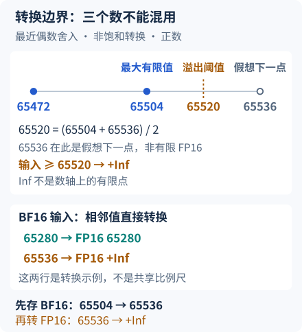
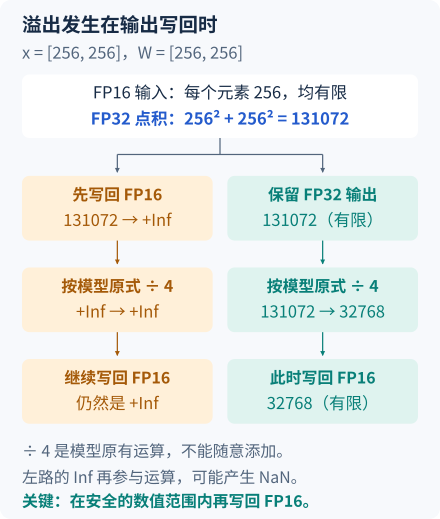

[第一篇](/2026/10/28/deep-learning-numerical-precision-basics/)介绍了数值格式的位分配与值域，[第二篇](/2026/10/28/deep-learning-floating-point-errors/)解释了舍入、溢出和累加误差。这一篇把它们用于一个具体问题：为什么模型用 BF16 能运行，切换到 FP16 后却出现 `Inf` 或 `NaN`？

关键是：**权重转换、前向中间值和反向梯度是三个不同的检查位置。某一步在 BF16 或 FP32 中得到有限值，下一步写入 FP16 时仍可能溢出。** 找到第一次异常，才能判断保留 BF16、局部 FP32 或调整梯度缩放是否有用。

本文实验已在 Windows x64、Python 3.12.14、PyTorch 2.15.0+cpu 环境运行。文中代码按顺序在同一个 Python 会话中执行，使用 CPU 张量进行显式类型转换。这里的例子用于验证表示与舍入，不测量 GPU 性能，也不推断具体 GPU 矩阵乘法的内部累加方式。边界讨论采用“舍入到最近值，平局取偶数”的非饱和转换；饱和转换、其他舍入方式不在同一结论内。

```python
import torch

print("PyTorch:", torch.__version__)
print("device: cpu")
```

## 1. 同为 16 bit，为什么不能直接替换？

这里只回顾与转换直接相关的区别：

| 格式 | 指数位 | 小数位 | 最大正有限值 |
| --- | --- | --- | --- |
| BF16 | 8 | 7 | 约 `3.3895 × 10^38` |
| FP16 | 5 | 10 | `65504` |

FP16 给小数部分分配了更多位，但指数范围缩小了。因此，不能把 BF16 转 FP16 简单理解成“精度全面降低”，也不能认为同样占两个字节就能安全替换。

如果一个已有的 BF16 值落在 FP16 的正规数范围内，它能够被 FP16 精确表示：目标格式有足够的小数位容纳它。但增加小数位不能找回更早存入 BF16 时丢掉的信息。很小的 BF16 值进入 FP16 的非正规区时，仍可能舍入或归零；这部分原理见第二篇，本篇重点讨论大值溢出。

还要先明确“改成 FP16”具体做了什么：

- `model.half()` 会原地转换模型的浮点参数与 buffers，权重本身的存储格式就变了。调用后再对同一个对象做对照实验，已经不是原来的 BF16 模型。
- `torch.autocast` 会按算子策略选择计算格式，不等于把整个模型的参数永久转成 FP16。不同算子的输出、累加方式仍需分别确认。

使用 autocast 时，不应为了“配合 AMP”先把整个模型和输入都手动 `.half()`。显式转换与 autocast 应作为不同路径分析，比较模型时使用独立副本。

## 2. 转换边界：65504、65520、65536 分别是什么？

### 2.1 最大有限值不等于开始舍入为无穷大的位置

FP16 在 `[32768, 65536)` 内的间隔是 32，最大的两个有限值是 65472 和 65504。为了分析边界，可以暂时设想指数范围还能向上延伸，那么下一个值会是 65536。

65504 与这个假想下一点之间的中点是：

```text
(65504 + 65536) / 2 = 65520
```

在通常的最近偶数舍入下，65504 的保留有效数末位为 1，而假想下一点的末位为 0，因此中点 65520 会向上舍入到这个需要更大指数的结果，最终得到 `Inf`。这里的 65536 **不是 FP16 的有限可表示值**，而是帮助推导溢出阈值的假想下一点；不是在计算“65504 与无穷大的中点”。

因此，65504 是最大有限值，而 65520 是这一舍入规则下的正向溢出阈值。例如，FP32 的 65519 会舍入回 65504；65520 则变成 `Inf`。负数按绝对值对称处理。

### 2.2 BF16 在附近根本没有 65504 这个值

BF16 在 `[32768, 65536)` 内的间隔是 256，因此边界附近相邻的两个 BF16 值是 **65280 和 65536**。前者能精确转成 FP16，后者转换后为 `Inf`。

原始的 65504 如果先存入 BF16，会舍入为更近的 65536。接下来再转 FP16，真正参与转换的已经是 65536，而不是最初写下的 65504。



图 1：FP16 局部刻度用于解释舍入阈值；BF16 转换卡片单独展示实际源值。箭头指向 `Inf` 表示转换结果，不把无穷大当作数轴上的有限点。

### 2.3 打印每一步实际保存的值

```python
source = torch.tensor(
    [65280.0, 65504.0, 65519.0, 65520.0, 65536.0],
    dtype=torch.float32,
)
direct = source.to(torch.float16)
via_bf16 = source.to(torch.bfloat16)
via_bf16_to_fp16 = via_bf16.to(torch.float16)

print("FP32 input | direct FP16 | stored BF16 | BF16 -> FP16")
for a, b, c, d in zip(source, direct, via_bf16, via_bf16_to_fp16):
    print(f"{a.item():.0f} | {b.item():.0f} | {c.item():.0f} | {d.item():.0f}")
```

结果如下：

```text
FP32 input | direct FP16 | stored BF16 | BF16 -> FP16
65280 | 65280 | 65280 | 65280
65504 | 65504 | 65536 | inf
65519 | 65504 | 65536 | inf
65520 | inf | 65536 | inf
65536 | inf | 65536 | inf
```

这个实验解释了“我写的数明明没有超过 65504，为什么仍然溢出”：检查时必须看**转换前张量实际保存的值**，不能只看生成它的十进制字面量。

对已有的有限 BF16 值，在这里约定的转换规则下，`abs(x) > 65504` 可以筛出转 FP16 会溢出的值，因为 BF16 在 65504 到 65520 之间没有可表示值。对任意 FP32 输入，这个条件则只是保守筛查，会把仍能舍入回 65504 的值也算进去。源格式是判断的一部分。

将这个条件写成 PyTorch 代码时，先把 BF16 张量精确转换到 FP32 再比较，避免标量阈值本身被转换到 BF16 后改变含义：

```python
overflow_risk = torch.isfinite(via_bf16) & (via_bf16.float().abs() > 65504.0)
print("finite BF16 values outside FP16 range:", overflow_risk.tolist())
```

```text
finite BF16 values outside FP16 range: [False, True, True, True, True]
```

本次实测中，直接写 `via_bf16.abs() > 65504.0` 会将比较阈值转换为 BF16 的 65536，漏掉恰好等于 65536 的危险值；先 `.float()` 再比较就能避免这个问题。这里单独筛选有限源值；源张量原本已有的 `Inf` 或 `NaN`，应另用有限性检查报告。

## 3. 权重没有溢出，模型为什么仍然异常？

考虑一个很小的点积：

```text
x = [256, 256]
w = [256, 256]
z = x · w = 256 × 256 + 256 × 256 = 131072
```

256 能被 FP16 精确保存，但结果 131072 超出了它的范围。假设点积先得到 FP32 的 131072，随后输出保存为 FP16，异常就发生在输出写回处。权重转换检查全部通过，也不能发现这个问题。

实际模型中，需要注意的路径包括：

| 位置 | 可能发生什么 | 应检查什么 |
| --- | --- | --- |
| BF16 checkpoint 加载与转换 | 某些参数或浮点 buffer 已超过 FP16 范围 | 转换前后实际值、dtype 和有限性 |
| 线性层、attention 点积、归约 | 有限输入的乘积或和变得很大 | 中间结果、累加与输出格式 |
| 残差相加、模块接口、缓存写入 | 上游结果正常，后续相加或转换越界 | 相加结果与实际写入缓存的值 |
| 训练反向传播 | 导数或缩放后的梯度超出范围 | 前向是否已经异常、哪一步梯度首次非有限 |

这些是需要检查的场景，不表示某类 BF16 模型的权重一定很大，也不表示所有 attention 实现都会这样溢出。融合算子可能改变计算顺序、缩放位置和中间格式，autocast 也可能让部分操作保持 FP32。

即使算子通常使用 FP32 累加，也要检查是否存在降低中间累加精度的优化，以及最终输出写回什么格式。关闭某项低精度归约优化，只能针对该优化引起的问题；如果数学结果本身超过 FP16 的输出范围，仍然需要处理输出格式。

此外，`Inf` 可能继续传播成 `NaN`。例如，当 softmax 接收到 `[Inf, Inf]`，常见的“先减去最大值”步骤会遇到 `Inf - Inf`。稳定公式可以避免对有限大数直接求指数的部分风险，却不能恢复上游已经丢掉的有限值。

```python
bad_logits = torch.tensor([float("inf"), float("inf")], dtype=torch.float32)
print(torch.softmax(bad_logits, dim=0).tolist())
```

```text
[nan, nan]
```

看到最后的 loss 或概率为 `NaN`，不能据此断定 softmax 就是根因。

**前向全部有限，也不保证反向安全。** 下面让参数保持 FP32，只改变一个中间激活的格式；这个实验没有使用梯度缩放：

```python
for dtype in (torch.float16, torch.bfloat16, torch.float32):
    parameter = torch.tensor(0.5, dtype=torch.float32, requires_grad=True)
    activation = parameter.to(dtype)
    activation.retain_grad()
    loss = activation.float() * 65536.0
    loss.backward()
    print(
        f"{dtype}: loss={loss.item():.0f}, "
        f"activation_grad={activation.grad.item():.0f}, "
        f"parameter_grad={parameter.grad.item():.0f}"
    )
```

```text
torch.float16: loss=32768, activation_grad=inf, parameter_grad=inf
torch.bfloat16: loss=32768, activation_grad=65536, parameter_grad=65536
torch.float32: loss=32768, activation_grad=65536, parameter_grad=65536
```

三条路径的 loss 都是有限的 32768，但反向时 `∂loss/∂activation = 65536`。FP16 激活接收的梯度无法容纳这个值，变成 `Inf` 后再传回 FP32 参数，仍然是 `Inf`。因此，参数和 loss 使用 FP32，也不能保证低精度反向路径安全。这个构造实验用于隔离梯度范围问题，不代表所有 AMP 训练都会出现该行为。

## 4. 怎样找到第一个异常位置？

先用同一份输入、同一个 checkpoint、相同的训练或推理模式复现问题。随后按实际执行顺序检查：

1. **转换前与转换后的参数、浮点 buffers 和输入。** 确认加载时已经损坏，还是转换引入了异常。
2. **前向各阶段的输入与输出。** 找到“上一处正常，这一处首次出现非预期的非有限值”的边界；必要时继续深入这个模块内部。
3. **loss 及其前置计算。** 如果这里已经非有限，先排查前向。
4. **反向梯度。** 前向全部正常时，再检查反向计算、loss scale，以及更新前的梯度。

一个小工具可以同时记录 dtype、非有限值数量和有限部分的最大绝对值：

```python
def inspect_tensor(name, tensor):
    values = tensor.detach()
    finite = torch.isfinite(values)
    nonfinite = int((~finite).sum().item())
    finite_values = values[finite]
    finite_absmax = (
        float(finite_values.abs().max().item())
        if finite_values.numel() else None
    )
    print(
        f"{name}: dtype={values.dtype}, nonfinite={nonfinite}/{values.numel()}, "
        f"finite_absmax={finite_absmax}"
    )
```

这里将非有限值单独计数，避免直接 `max()` 得到 `NaN` 后丢失其他信息。`finite_absmax` 只描述有限部分，**不能单独用它判断整个张量正常**；如果所有元素都非有限，会显示 `None`。

非有限值的数量也不能直接等同于异常数量。例如，attention mask 可能有意将被屏蔽位置设为 `-Inf`；本次 CPU 实测中，`softmax([2, -Inf])` 得到正常的 `[1, 0]`。应结合掩码语义，区分预期的屏蔽值与计算产生的异常，继续检查有效位置和下游输出。整行全部被屏蔽时，还需确认具体实现的处理方式，不能把所有 `-Inf` 都直接忽略。

可在 `named_parameters()` 和 `named_buffers()` 的遍历中调用它，也可在可疑操作前后直接调用。模块的 forward hook 能帮助定位模块边界，但无法自动覆盖内部所有函数式操作、类型转换或融合算子；定位到模块后仍要继续细查。

这些日志在 GPU 上可能引入同步和开销，适合缩小到复现样本与可疑层使用。量级偏大只是线索；除零、无效数学运算等也会产生非有限值，不能把所有 `NaN` 都归因于 FP16 溢出。

## 5. 处理方式必须对应异常位置

| 已定位的原因 | 可以考虑的处理 | 适用边界 |
| --- | --- | --- |
| 权重或 buffer 转换就溢出 | 保留 BF16，或在转换前选择能容纳它的格式 | 已变成 Inf 后再 `.float()` 无法恢复，需要从原始数据重新加载 |
| 前向中间值或输出写回溢出 | 让敏感计算及必要输出保持 FP32，或保留 BF16 路径 | 只提高累加精度、紧接着写回 FP16，可能仍然失败 |
| 不稳定的运算形式 | 使用稳定公式，或经证明等价的缩放与运算重排 | 需要检查中间格式与舍入变化，不能任意改变模型计算 |
| 前向正常，反向梯度溢出 | 区分导数本身过大与 loss scale 的影响，检查反向计算格式及动态缩放 | 必要时保留 BF16/FP32 路径；梯度缩放不能修复前向或权重转换溢出 |

### 5.1 关闭 autocast 还不等于张量已经变成 FP32

对于 autocast 区域中的敏感操作，可以在局部禁用 autocast，并在运算前显式将相关输入转换到 FP32。**禁用 autocast 不会自动把已有的 FP16 张量升成 FP32。** 如果输入在前一步已经是 `Inf`，这时 `.float()` 也没有恢复作用。

局部 FP32 计算结束后，还要沿着数据流继续检查：输出是否马上转回 FP16？下一个算子是否又会转换它？如果大的中间值需要保留到后续运算之后，FP32 区域就应覆盖那段必要的路径。

### 5.2 GradScaler 能做什么，不能做什么？

梯度缩放会在反向前将 loss 乘以 scale，使相关梯度同步缩放；通常通过放大来缓解低精度反向路径中的小梯度下溢。常规 AMP 用法会在更新前取消梯度缩放；检测到非有限梯度时，跳过对应优化器的更新并调整缩放因子。

调用 `scaler.scale(loss).backward()` 后，参数的 `.grad` 仍处于缩放后的尺度。若要比较实际梯度幅值或进行常规梯度裁剪，应在本次更新所需的梯度累积全部完成后，先调用一次 `scaler.unscale_(optimizer)`，再检查梯度，确认有限后再裁剪，最后调用 `scaler.step(optimizer)` 和 `scaler.update()`。同一优化器在每次更新中至多显式调用一次 `unscale_`；如果为了定位问题记录取消缩放前后的梯度，要同时标明当时的 scale，避免把缩放带来的幅度变化误判成异常。

缩放本身也可能使某些梯度过大。因此，scale 会动态调整，**不保证始终大于或等于 1**。这不意味着 FP16 的表示范围发生了改变。

如果前向激活早已变成 `Inf`，再降低反向的 loss scale 不能修复这一次前向结果。对于本身不适合 FP16 范围的模型，也不能期待 GradScaler 保证训练稳定。

同样，梯度裁剪作用在梯度上，无法修复前向溢出；已经出现非有限梯度时，也不能把裁剪当成可靠的数值恢复方法。直接把大值截断到 65504 则会改变模型数值，不是无损处理。

## 6. 贯穿案例：把转换延后到安全的位置

下面使用一个**人为构造的点积计算片段**，完整计算是：

```text
y = (x · w) / 4
x = w = [256, 256]
精确中间值 z = 131072，精确最终值 y = 32768
```

除以 4 本来就是这个计算定义的一部分。这里要比较的是：能否把中间结果的 FP16 写回，延后到原有除法之后；不是给真实模型随意增加一次除法。

为明确定位，代码强制先用 FP32 做点积，再显式选择中间结果的保存格式。它不调用原生 FP16/BF16 GEMM，因此不会把 CPU 或 GPU 内核的内部实现当成实验前提。

```python
def run_path(dtype, keep_intermediate_fp32=False, verbose=False):
    x = torch.tensor([256.0, 256.0], dtype=dtype)
    w = torch.tensor([256.0, 256.0], dtype=dtype)
    z32 = torch.dot(x.float(), w.float())

    # 在这里选择中间结果的保存格式。
    stored = z32 if keep_intermediate_fp32 else z32.to(dtype)
    # 显式用 FP32 执行原有除法，隔离上一步写回造成的影响。
    y32 = stored.float() / 4.0
    output = y32.to(dtype)

    if verbose:
        for name, value in [
            ("input", x), ("weight", w), ("dot_fp32", z32),
            ("stored", stored), ("output", output),
        ]:
            inspect_tensor(name, value)
    return stored, output


paths = [
    ("FP32 reference", torch.float32, False),
    ("BF16 storage", torch.bfloat16, False),
    ("FP16 early cast", torch.float16, False),
    ("FP16 delayed cast", torch.float16, True),
]
results = {}
for name, dtype, keep in paths:
    stored, output = run_path(dtype, keep)
    results[name] = output
    print(f"{name}: stored={stored.item():.0f}, output={output.item():.0f}")

print("--- locate the first nonfinite value ---")
run_path(torch.float16, verbose=True)

print("--- compare repaired output with reference ---")
reference = results["FP32 reference"]
repaired = results["FP16 delayed cast"].float()
print("finite:", bool(torch.isfinite(repaired).item()))
print("absolute error:", abs((repaired - reference).item()))
```

输出为：

```text
FP32 reference: stored=131072, output=32768
BF16 storage: stored=131072, output=32768
FP16 early cast: stored=inf, output=inf
FP16 delayed cast: stored=131072, output=32768
--- locate the first nonfinite value ---
input: dtype=torch.float16, nonfinite=0/2, finite_absmax=256.0
weight: dtype=torch.float16, nonfinite=0/2, finite_absmax=256.0
dot_fp32: dtype=torch.float32, nonfinite=0/1, finite_absmax=131072.0
stored: dtype=torch.float16, nonfinite=1/1, finite_absmax=None
output: dtype=torch.float16, nonfinite=1/1, finite_absmax=None
--- compare repaired output with reference ---
finite: True
absolute error: 0.0
```



图 2：两条路径执行相同的点积与原有缩放，区别在中间值何时写回 FP16。图中的数值对应本节构造案例。

日志把首次异常定位到了 `stored`：输入、权重和 FP32 点积结果都有限，提前写回 FP16 才产生 `Inf`。之后即使 `.float()` 再除以 4，也只能得到 `Inf`。

修改后，中间结果保留为 FP32，先执行本来就有的除法，再把 32768 写回 FP16。这个最终值可精确表示，因此本例相对于参考结果的绝对误差为零。BF16 路径也能精确保存本例的两个结果。

这个例子证明的是**改变中间结果保存位置，可能避免不必要的范围损失**，不是所有模型都有一个恰好让数值缩回安全范围的后续步骤。如果最终必须保存的值仍然超出 FP16 范围，延后转换也不能解决问题。

真实模型还需要在相同输入上比较误差、任务指标，以及显存和速度；本例没有测量这些指标。即使输出全部有限，也不代表模型效果已得到保证。

## 小结

BF16 转 FP16 的风险来自更窄的表示范围。65504 是最大有限值，65520 是指定舍入规则下的正向溢出阈值，而 BF16 的实际可表示值又决定了源张量可能落在哪里。

排查时从转换前后的参数与输入开始，沿着前向、loss 和反向找第一个非预期的非有限值，并结合掩码语义和梯度缩放阶段判断。处理方法要覆盖真正出错的计算与保存位置，并通过参考结果和模型评测验证；只看模型名称、某一个 dtype，或最后的 loss，都不足以解释整条路径。

## 参考资料

- [PyTorch：Automatic Mixed Precision](https://docs.pytorch.org/docs/2.15/amp.html)：autocast、局部禁用时的显式转换、梯度缩放与 BF16 模型切换 FP16 的范围风险。
- [PyTorch：AMP examples — Gradient clipping](https://docs.pytorch.org/docs/2.15/notes/amp_examples.html#gradient-clipping)：取消梯度缩放、梯度裁剪与累积时机。
- [PyTorch：Module.half](https://docs.pytorch.org/docs/2.15/generated/torch.nn.Module.html#torch.nn.Module.half)：模型浮点参数和 buffers 的原地转换。
- [PyTorch：Numerical accuracy](https://docs.pytorch.org/docs/2.15/notes/numerical_accuracy.html)：中间计算、FP16/BF16 GEMM 归约精度与非有限值的限制。
- [NVIDIA：Floating Point and IEEE 754](https://docs.nvidia.com/cuda/floating-point/index.html)：浮点表示与舍入模式。
