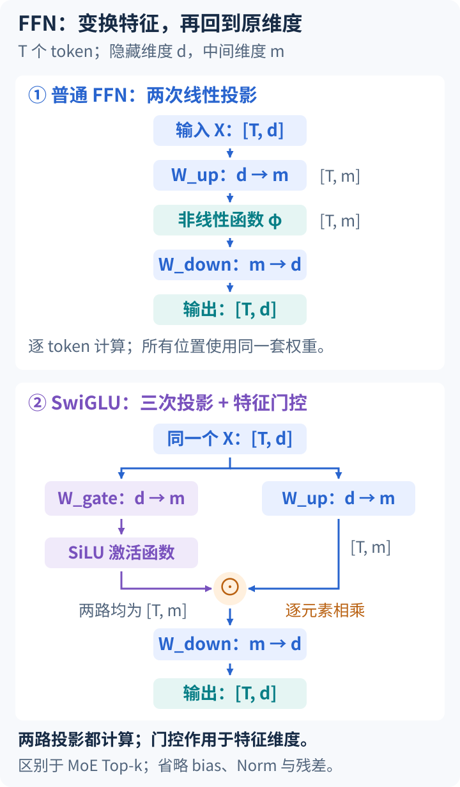
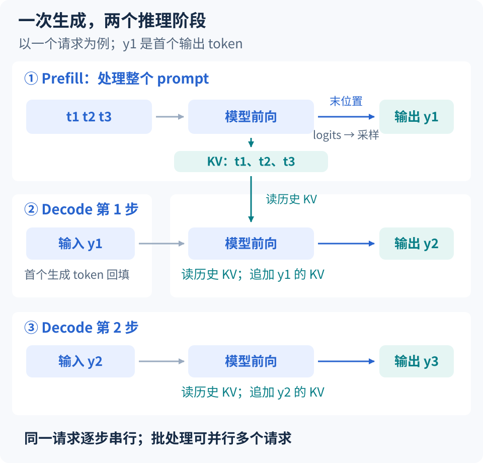
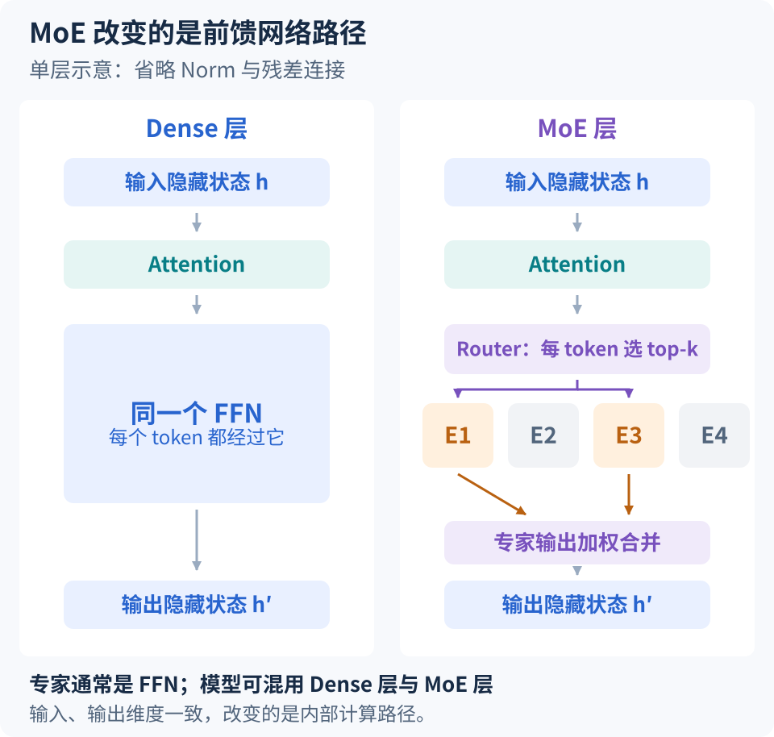
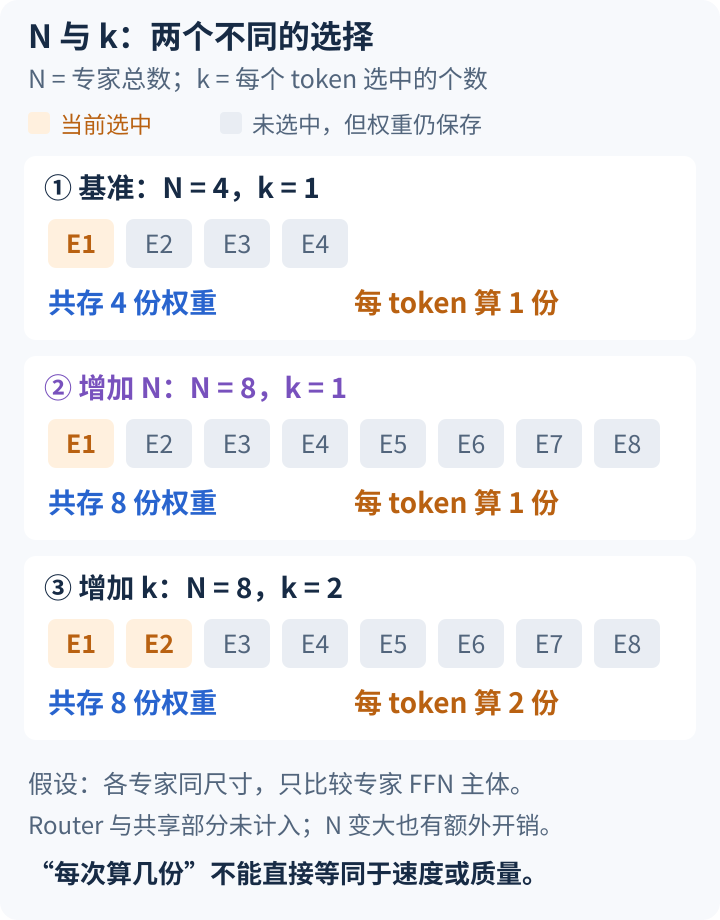
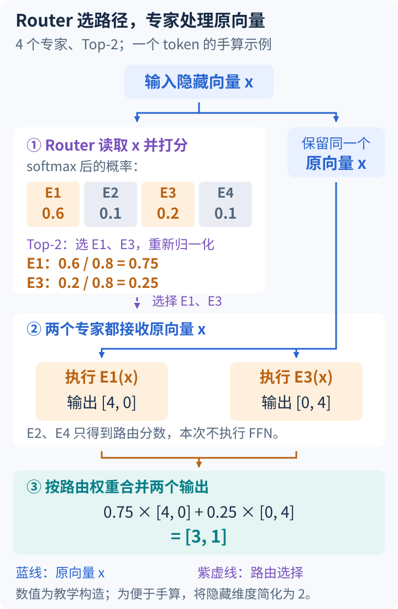
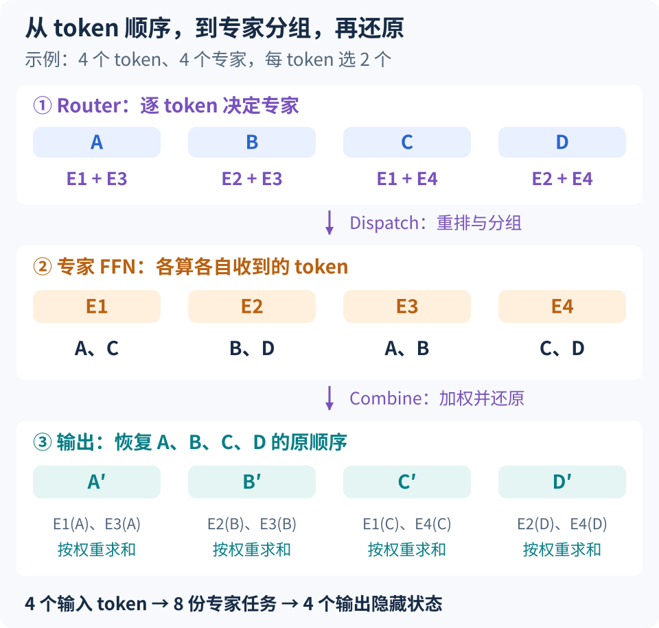
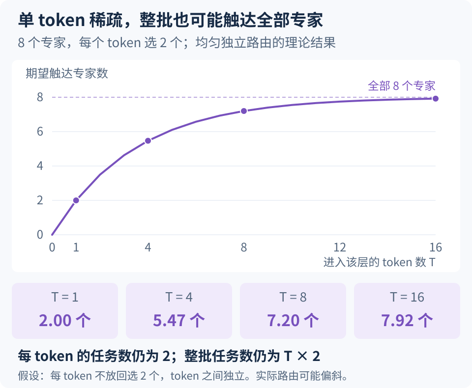
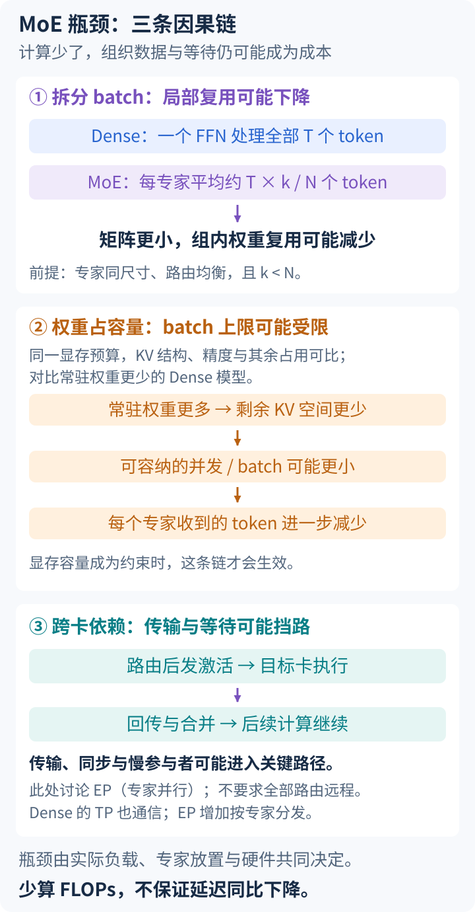
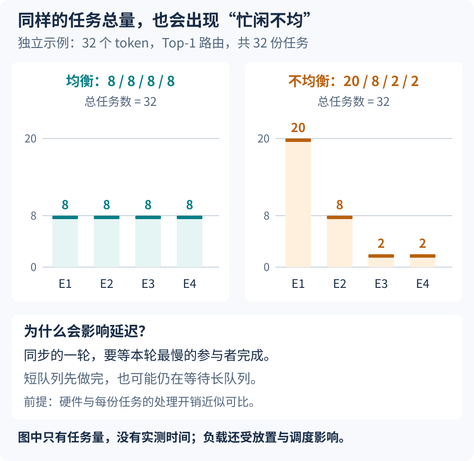
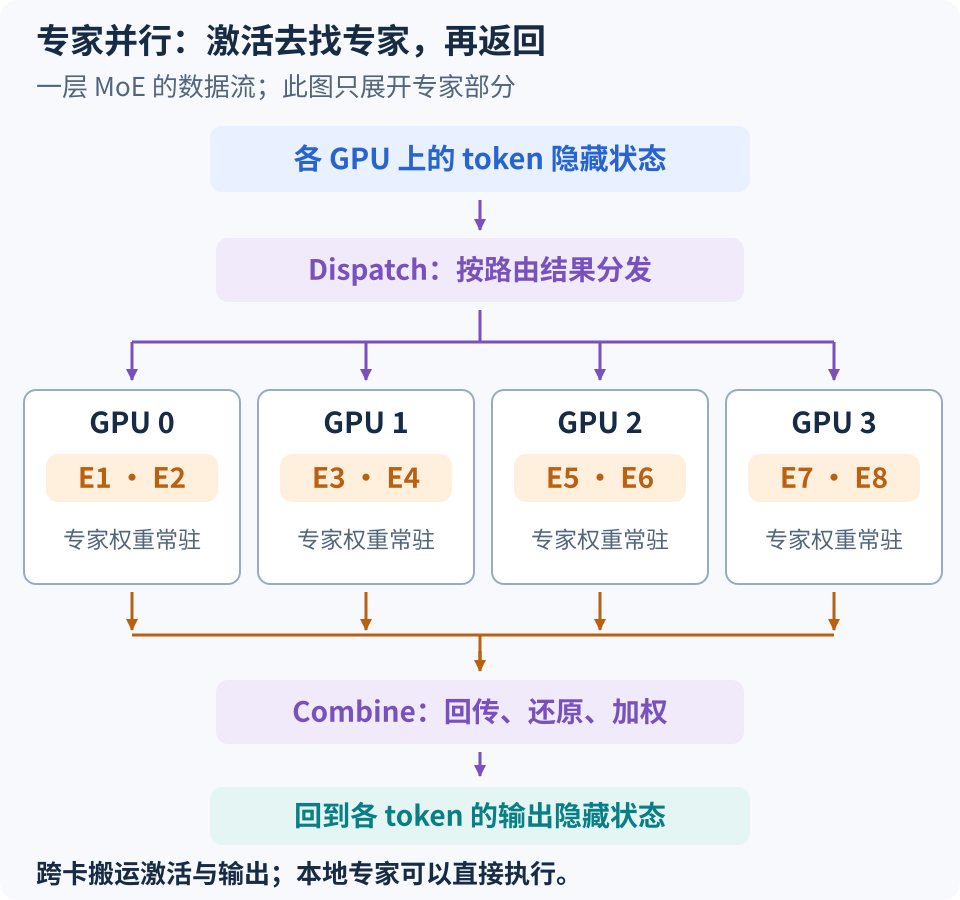

看 MoE 模型的介绍时，经常会遇到两组参数：**总参数量**和**每个 token 的激活参数量**。例如，一个模型有数千亿总参数，却只让其中数百亿参数参与一次 token 计算。直觉上，它似乎既有大模型的容量，又有小模型的速度。

但真正部署起来，就会发现几个问题：为什么激活参数不多，显存还是不够？为什么同一模型换一种 batch size，吞吐差这么多？为什么 GPU 算力很强，生成速度却被卡间通信拖住？

理解这些现象，要先把三件事分开：**每个 token 算多少、整个模型存多少、一次执行要搬多少数据。** MoE 主要改变了第一件事，也会改变第三件事，但不会自动按相同比例减少第二件事。

本文面向接触过 Dense LLM、但还没有学过 MoE 的读者。我们先回顾推理过程，并把 FFN 的内部计算拆开，再看它如何变成多个可选的专家。读到第 5 节，就能建立 MoE 的基本概念；第 6 节起进一步讨论批处理和多卡部署中的性能问题。

讨论以常见 decoder-only Transformer、使用 KV cache 的自回归生成，以及 token-choice 路由为主——也就是由每个 token 选择要执行的专家。文中的算例和曲线用于解释原理，**不是 GPU 性能实测，也不能用来推算某款模型的实际 tokens/s**。配图均可点击打开 SVG 原图查看细节。

## 1. LLM 推理与 FFN
{: id="1-llm-推理模型如何生成下一个-token"}

### 1.1 Token 与文本生成
{: id="11-从文字到概率分布"}

用户输入一段文字后，推理服务大致完成下面这些步骤：

```text
对话内容 → chat template → tokenizer → token IDs
        → embedding → 多层 Transformer → 最终归一化与 LM head
        → 下一个 token 的 logits → 按解码规则选择 token
```

Token 是模型处理的离散单位，不一定对应一个汉字或一个英文单词。Embedding 把 token ID 转换成向量；Transformer 层反复更新这个向量；LM head 把最后位置的表示映射成词表上各个候选 token 的分数。

选择下一个 token 时，可以取分数最高的一项，也可以按温度、Top-p 等规则采样。把选出的 token 接回上下文，再重复这个过程，就得到逐字输出的效果。实际上，前端显示的一个“字”与模型生成的一个 token 也未必一一对应。

这里最重要的依赖关系是：**同一条普通自回归序列，要先确定前一个输出 token，才能把它作为输入继续生成后一个。** 服务可以同时处理多个请求，也可以使用推测解码等技术优化执行，但这不等于普通解码能一次独立算出所有未来 token。

### 1.2 Transformer 层结构
{: id="12-一层-transformer-主要做什么"}

可以先把一层理解为两个主要模块：

- **Attention**：让当前位置从上下文中的其他位置读取信息。生成模型通常使用因果注意力，不能读取未来 token。
- **FFN / MLP**：对每个位置的向量进行非线性变换。不同位置调用相同的参数，但各自计算，不通过这个模块直接交换位置之间的信息。

现代模型常见的 FFN 是 SwiGLU 一类门控结构：两路投影产生中间表示，做激活与逐元素相乘，再投影回原来的隐藏维度。Attention、FFN 周围还会有归一化和残差连接，具体排列依模型而定。

后面所说的常见 MoE，主要就是把其中的**单个 FFN 替换成多个可选择的 FFN 专家**。Attention 通常仍然存在。

### 1.3 FFN 的内部结构
{: id="13-把-ffn-拆开升维非线性降维"}

FFN 是 Feed-Forward Network，前馈网络。在 Transformer 语境中，它通常指每层 Attention 之外、作用于各个 token 表示的那一段小型神经网络，也常被称为 MLP。这里的“前馈”描述的是内部计算顺序，不表示整个语言模型不再自回归。

先看一个没有门控的普通 FFN。把单个 token 的隐藏表示 `x` 写成行向量，常见形式为：

```text
u = x W_up + b_up        # 从 d 维映射到 m 维
a = φ(u)                # 逐元素非线性变换，例如 ReLU 或 GELU
y = a W_down + b_down    # 从 m 维映射回 d 维
```

`W_up`、`W_down` 和 bias 都是训练得到的参数；`φ` 是激活函数。`d` 是 Transformer 的隐藏维度，`m` 是 FFN 的中间维度，通常比 `d` 大，但没有必须等于 `4d` 的通用规定。

| 对象 | 单 token 时的形状 | 一批 T 个 token 时的形状 |
| --- | --- | --- |
| 输入 | `x: [d]` | `X: [T, d]` |
| 升维权重 | `W_up: [d, m]` | 同一份权重，形状不变 |
| 非线性变换后的中间值 | `a: [m]` | `A: [T, m]` |
| 降维权重 | `W_down: [m, d]` | 同一份权重，形状不变 |
| 输出 | `y: [d]` | `Y: [T, d]` |

例如 `d = 4`、`m = 8` 时，每个 token 的表示经历 `4 → 8 → 4` 的变换。中间维度扩大，给模型更多可学习的特征组合；最后回到 `d` 维，使输出能与残差分支相加，并继续进入下一层。**回到原来的维度，不代表恢复原来的向量**：FFN 的任务正是学习新的表示。

非线性也很关键。若把 `φ` 去掉，两次线性投影可以合并为 `x (W_up W_down)`，连同 bias 也只是一次仿射变换。加入非线性后，才不再能简单地合并成同一种线性映射。

这里还要区分两个方向：Attention 让 token 从其他位置读取信息；FFN 主要在**一个 token 的特征维度内**做变换。FFN 本身不把不同 token 的向量混起来，但它接收的向量已经包含 Attention 汇入的上下文，所以“逐 token 计算”不等于“看不到上下文”。同一层的各位置共用 FFN 权重，不同层通常各有自己的 FFN 权重。

### 1.4 SwiGLU 门控
{: id="14-swiglu为什么现代-ffn-常有三块矩阵"}

不少现代 LLM 使用带门控的 FFN，例如 SwiGLU。忽略 bias，其内部可以写成：

```text
u = x W_up                   # 内容分支，形状 [m]
g = SiLU(x W_gate)           # 门控分支，形状 [m]
z = g ⊙ u                   # 对应坐标逐元素相乘，形状 [m]
y = z W_down                # 投影回 [d]

SiLU(t) = t × sigmoid(t)
```

两条分支都读取同一个 `x`，只是使用不同的权重。符号 `⊙` 表示对应坐标相乘，不是矩阵乘法：例如 `z_j = g_j × u_j`。这样，中间特征的缩放会随输入而变化；门控分支的值并不是必须落在 `[0, 1]` 的概率。

[](/img/posts/moe-inference/ffn-and-swiglu.svg)

*图 1：只展示 FFN 内部，省略 bias、归一化和残差连接。两种结构的输出维度都回到 d，SwiGLU 的两路投影都会执行。*

普通两层 FFN 的主要权重约为 `2dm` 个；SwiGLU 有 `W_up`、`W_gate`、`W_down` 三块矩阵，约为 `3dm` 个。这个比较假设二者使用相同的 `d` 和 `m`；实际模型会调整中间维度，所以不能只按矩阵数量判断两个模型谁更大。

理解这里的门控，后面会少一个混淆：**SwiGLU 的门控调节中间特征，MoE 的 Router 选择整组 FFN 专家。** 一个 MoE 专家自己也可以是 SwiGLU，它里面的两条分支通常照常计算；“稀疏”发生在这一层选择了哪些专家。

## 2. Prefill 与 Decode
{: id="2-prefill-与-decode同一模型的两种工作状态"}

### 2.1 Prefill：处理输入
{: id="21-prefill处理已经知道的输入"}

假设 prompt 包含 1,000 个 token。这些 token 的内容已经全部确定，因此 prefill 可以在各层中以较大的矩阵批量处理它们，同时用因果 mask 保证每个位置只关注允许的历史位置。

在这个阶段，模型还会建立后续生成需要的 KV cache。对普通生成而言，**prompt 最后一个有效位置的 logits 就能用于选择第一个输出 token**，不必先把同一段 prompt 再完整跑一次。

### 2.2 Decode：逐步生成
{: id="22-decode每轮继续一个位置"}

首个输出 token 被选出后，模型把它作为下一轮输入，经过各层，得到再下一个 token 的分布。在使用缓存的常规解码中，一个活跃请求每轮通常只新增一个输入位置；动态 batch 可以把多个请求这一轮的新位置放在一起计算。

[](/img/posts/moe-inference/prefill-decode.svg)

*图 2：首个输出来自 prefill 的末位置 logits。后续 decode 的输入是上一轮已选出的 token。图中省略了服务排队与调度。*

二者的性能特点往往不同：

| 观察项 | Prefill | Decode |
| --- | --- | --- |
| 一个请求本轮处理的位置 | 通常是多个 prompt token，也可能按块处理 | 常规情况下是一个新位置 |
| 矩阵计算形状 | 通常更大，更容易复用权重 | 小 batch 下矩阵较小，权重复用较弱 |
| 常见压力 | 矩阵计算、长上下文 attention、激活与工作区 | 权重读取、历史 KV 读取、调度与通信延迟 |
| 用户直接感受到的指标 | 首 token 等待时间的一部分 | 后续 token 输出间隔 |

这张表是常见趋势，不是固定分类。长上下文 decode 可能受 attention 和 KV 读取限制；大 batch decode 也可能接近计算瓶颈；很短的 prefill 则未必能充分使用 GPU。

### 2.3 KV cache 的作用
{: id="23-kv-cache-缓存了什么"}

Attention 会从输入表示生成 Query、Key、Value。生成新 token 时，新位置的 Query 需要与历史位置的 Key、Value 交互。KV cache 保存各层历史位置的 Key、Value，使后续步骤不必重复计算它们。

**KV cache 不缓存一整套“未来答案”，也不能免去读取历史 KV 和计算当前 attention 的开销。** 上下文越长，常规全注意力 decode 需要处理的历史通常越多。

对普通 MHA / GQA / MQA，在各层配置相同、K/V 维度一致、未做压缩的简化条件下：

```text
KV cache 字节数 ≈ 2 × L × B × S × H_kv × D_head × b_kv

2       ：分别保存 K 和 V
L       ：缓存的 attention 层数
B       ：并发序列数
S       ：每条序列当前缓存的 token 数
H_kv    ：KV head 数，GQA 中通常小于 Query head 数
D_head  ：每个 head 的维度
b_kv    ：每个缓存元素占用的字节数
```

不同序列长度不同时，用所有序列缓存长度的总和替换 `B × S`。分页分配、量化元数据、对齐等还会带来额外占用。MLA、滑动窗口等结构需要按自己的缓存方式计算，不能直接照搬这条公式。

注意公式里没有“FFN 专家个数”。**在 attention 结构、层数、精度和请求负载相同的前提下，把 FFN 换成 MoE，不会自动缩小 KV cache。**

## 3. 从 Dense 到 MoE
{: id="3-从-dense-ffn-到-moe稀疏发生在哪里"}

### 3.1 Dense 的计算路径
{: id="31-dense每个-token-走相同的-ffn"}

在普通 Dense Transformer 中，一层里的所有 token 都会经过同一个 FFN。把这一层收到的 token 表示合起来，可以写成一个形状为 `[T, d]` 的矩阵：`T` 是本轮送入该层的 token 总数，`d` 是隐藏维度。

这里的 Dense 指的是计算结构。即使某些激活数值很小、等于零，也不表示常规稠密计算算子（dense kernel）就会自动跳过对应的权重计算；它通常仍执行完整的稠密矩阵乘法。

### 3.2 MoE 的设计动机
{: id="32-为什么不直接把原来的-ffn-做得更大"}

沿着 Dense 的思路，要增加 FFN 的可学习参数，一个直观办法是增大中间维度 `m`。但这样也会增加每个 token 需要执行的矩阵运算：模型有了更多参数，每次使用它时也通常要多算。

MoE 提供了另一种选择：**准备多套不同的 FFN 权重，让不同 token 按需使用其中一部分。** 这使“模型一共拥有多少可学习参数”和“一个 token 要执行多少参数”能够部分分开。这里的参数容量指可学习权重的规模，不保证扩大容量就一定获得更好的回答；效果仍取决于训练是否有效。

也别把它理解成给原来的 FFN 免费提速：如果每个专家与原 Dense FFN 一样大，Top-2 就要执行两份 FFN，专家部分的算术量约为原来一份的两倍。它减少的是相对执行整个专家池的计算；能否在相同质量下比某个 Dense 模型更划算，需要另外比较。

### 3.3 专家总数与 Top-k
{: id="33-moe每个-token-选择一部分专家"}

MoE 是 Mixture of Experts，混合专家。常见的稀疏 FFN MoE 在一层里放置 `N` 个专家，每个专家本身通常仍是一个稠密 FFN，再用 Router 决定当前 token 交给其中哪 `k` 个专家处理，通常 `k` 远小于 `N`。

[](/img/posts/moe-inference/dense-vs-moe-block.svg)

*图 3：两条路径接收并输出相同隐藏维度的表示。图为结构简化，实际模型可能只在部分层使用 MoE，也可能包含共享专家。*

专家不是一个个完整的大语言模型。它们通常只是某一层里的 FFN 参数集合；一个 token 经过不同 MoE 层时，会在每层重新路由。因此，也不能理解成“整段请求先选中两个专家，然后一直只用这两个”。

“专家”也不保证是人工划定的“数学专家”“代码专家”“语文专家”。路由和专家参数来自训练，可能形成某些偏好，但不能仅凭名称就把它们解释成独立、明确的业务角色。

理解专家池时，要记住两个不同的数：`N` 是这一层有多少个路由专家，`k` 是一个 token 在这一层选多少个。`N = 8, k = 2` 就是“存着 8 套，当前 token 执行其中 2 套”；灰掉的专家仍然有参数，只是当前 token 不调用它们。

[](/img/posts/moe-inference/capacity-vs-compute.svg)

*图 4：只比较同尺寸路由专家的主体权重和算术量。增加 N 仍会增加 Router 等开销；这是架构设计的对比，不是允许随意修改已有模型的推理设置。*

所以，MoE 的“稀疏”主要是**执行路径稀疏**，不意味着每个专家的矩阵里面有很多零。文中的“激活参数”指当前 token 路径使用的参数；通信时说的“激活”则指计算过程产生的中间向量，两者要分开理解。

### 3.4 路由与加权合并
{: id="34-router-怎么选从一个-token-手算到输出"}

以常见的一种 Top-k 方案为例，Router 读取当前 token 的表示 `x`，产生 `N` 个分数，再选出 `k` 个专家。选中专家的输出按照路由权重加权求和：

```text
selected(x) = TopK(router_scores(x), k)
y(x) = Σ [g_i(x) × Expert_i(x)]，i 属于 selected(x)
```

其中 `g_i(x)` 是相应的混合权重。一种常见做法是对选中专家的分数进行 softmax，使权重之和为 1；也有模型使用其他评分、归一化、缩放或分组选择方法，必须以具体模型为准。

常见 Router 可以用一个可学习的线性投影 `x W_router` 产生所有专家的分数，其中 `W_router` 的形状为 `[d, N]`。**算出 N 个分数，不需要先运行 N 个专家 FFN。** Router 不会先让所有专家各答一次，再挑答案最好的两个。

下面把分数、选择和合并连起来。为便于手算，设一个 token 的 Router 对全部专家做 softmax 后，得到概率 `[0.6, 0.1, 0.2, 0.1]`。选择 Top-2，并对选中概率重新归一化：

| 步骤 | 本例结果 |
| --- | --- |
| 选择专家 | E1 的 0.6 和 E3 的 0.2 最大，选 E1、E3 |
| 归一化混合权重 | E1：`0.6 / 0.8 = 0.75`；E3：`0.2 / 0.8 = 0.25` |
| 执行专家 | E1 和 E3 都接收原隐藏向量 `x`；本例给定输出分别为 `[4, 0]`、`[0, 4]` |
| 合并结果 | `0.75 × [4, 0] + 0.25 × [0, 4] = [3, 1]` |

对全部分数先做 softmax、再对选中概率归一化，与只对选中分数做 softmax 在这里是等价的。例中的概率和专家输出是为教学构造的，不对应真实模型；向量也缩成了两维。

[](/img/posts/moe-inference/router-worked-example.svg)

*图 5：Router 输出的是选择信息和混合权重，专家输入的仍是原隐藏向量 x。E2、E4 被打了分，但没有为当前 token 执行 FFN。*

合并的是**向量表示**，不是两份自然语言答案。这个结果经过残差等后续处理后，会继续进入模型下一层；到了另一个 MoE 层，会用更新后的表示重新路由。第 5 层的 E1 与第 6 层的 E1 通常是不同参数，编号不能跨层当成同一个专家。

一些模型还加入**共享专家**：每个 token 都会经过共享专家，同时经过 Router 选中的路由专家。统计激活参数时，共享专家和其他始终执行的部分都需要计入。

“共享专家”特指额外设置的、始终执行的 FFN 路径；它与各 token 都使用的 Attention 等共享模块不是同一个概念。上面的手算只展开路由专家部分，没有加入共享专家。

### 3.5 专家与路由的训练
{: id="35-这些专家与路由规则从哪里来"}

Router 和专家的参数需要通过训练学习。训练目标仍然包含语言模型的预测任务，具体方法还可能加入负载均衡等设计，让专家得到合适的使用与训练。理解推理时，先记住两点：**常规推理不会更新这些权重，但每个 token 的路由选择可以变化。**

Router 读取的是当前层的隐藏表示，其中包含上下文信息，不是只看一个固定的 token ID。因此，同一个词出现在不同上下文中，或位于不同层时，都可能选中不同专家。

这也意味着 MoE 通常不是普通 Dense 模型的一个推理开关。把 Dense FFN 复制几份，并不会自动得到学会分工的 MoE；从 Dense 初始化的构建方法也需要相应训练。部署已有 MoE 时，同样不能随意把 Top-2 改成 Top-1，并假定只是“少算一点、答案不变”：执行路径改变了，模型质量需要重新验证。

## 4. MoE 层的执行流程
{: id="4-一次-moe-层计算实际经历了什么"}

看一个具体的 Top-2 例子。当前有 4 个 token：A、B、C、D，Router 给出如下选择：

| Token | 选中的专家 |
| --- | --- |
| A | E1、E3 |
| B | E2、E3 |
| C | E1、E4 |
| D | E2、E4 |

计算引擎通常不会按 A、B、C、D 的顺序，逐个 token 分别启动小算子。更常见的方式是按专家重排，把交给同一专家的 token 放在一起计算：

[](/img/posts/moe-inference/token-routing.svg)

*图 6：4 个 token、Top-2，一共形成 8 次 token—expert 分配。每个 token 的最终结果仍是一份向量。*

整个过程可以拆成五步：

1. **路由**：计算分数、选择专家、保存混合权重。
2. **分组与分发**：按专家重排 token；需要时把激活发送到专家所在的 GPU。
3. **专家计算**：每个专家处理分到自己的小批量 token，常见优化包括 grouped GEMM（将多个专家的矩阵乘法成组执行）和融合算子。
4. **回收与还原**：把输出送回对应 token 的位置。
5. **加权合并**：根据混合权重，把同一 token 的多个专家输出累加。

单卡执行也需要路由、重排和合并，只是不需要跨 GPU 网络传输。有些实现会融合其中多个步骤，因此不能把这个逻辑分解机械地理解成五次独立 kernel 调用。

与 Dense 相比，MoE 不只是“少做几次矩阵乘法”。它把规则的大矩阵计算，变成了**由数据决定的分组计算**。少算的收益，要和分组、读写、通信等成本放在一起看。

## 5. 参数、计算与显存
{: id="5-参数量计算量显存三本不同的账"}

### 5.1 总参数与激活参数
{: id="51-总参数与激活参数如何计算"}

先用一个理想化模型帮助建立直觉。假设所有 MoE 层的专家配置一致：

```text
P_common：共享部分参数，包含 attention、共享专家等非路由专家参数
P_expert：在所有 MoE 层中，各取一个同尺寸路由专家的参数量之和
N       ：每个 MoE 层的路由专家数
k       ：每个 token 在每个 MoE 层选中的专家数

P_total  = P_common + N × P_expert
P_active ≈ P_common + k × P_expert
```

这里的 `P_expert` 是为了汇总全模型而定义的量，不是单层一个专家的大小。各层专家数、尺寸或 Top-k 不一致时，需要逐层求和。

设 `P_common = 4B`、`P_expert = 6B`、`N = 8`、`k = 2`，其中 `B` 表示十亿参数：

```text
总参数量    = 4 + 8 × 6 = 52B
激活参数量  ≈ 4 + 2 × 6 = 16B
```

因为共享部分仍然执行，激活参数占比并不是简单的 `2 / 8`。这个模型的比例约为 `16 / 52 ≈ 30.8%`。

模型公布的“激活参数”还可能有 embedding、输出头等计数口径差异。它适合帮助理解模型规模，但不能直接充当精确的算子统计。

### 5.2 激活参数与计算量
{: id="52-少激活参数主要省哪部分计算"}

沿用第 1 节的 SwiGLU 结构，忽略 bias，隐藏维度为 `d`、中间维度为 `m` 时，三块投影矩阵约有 `3dm` 个参数。FLOPs 表示浮点运算次数；如果一次乘加按 2 FLOPs 计，单 token 的主要矩阵乘法约为 `6dm` FLOPs。

在同尺寸专家的简化比较中，Top-k 执行的路由专家矩阵计算量约为全部 `N` 个专家都执行的 `k / N`。但这个比例只描述**专家部分**，还没有包括 attention、Router、输出头、其他逐元素操作，以及实际硬件利用率。

经常听到的“每 token 计算量约为两倍激活参数量”，也是对主要线性层矩阵运算的粗估。Embedding 查表并非遍历整张表做乘法；attention 对历史位置的交互还与上下文长度有关。精确估算时应按实际算子计算。

尤其要区分比较基准：上面的 52B MoE，相对一个约 52B 的 Dense 模型，主要线性层算术量可能显著减少；相对一个约 16B 的 Dense 模型，却未必还有同样的算术优势，而且承担了更多权重存储和路由工作。这两个问题不能用同一句“MoE 更快”回答。

### 5.3 权重与显存占用
{: id="53-为什么显存通常仍按总参数准备"}

因为下一个 token 可能选中另一组专家。常见的全 GPU 常驻部署，会把全部专家权重放在 GPU 上，或者分布在多张 GPU 上；每个 token 只是选择其中一部分执行。

[](/img/posts/moe-inference/memory-ledger.svg)

*图 7：三类占用不是固定比例。多卡分片时应分别计算每张卡上的实际权重、缓存和工作区。*

仍以前面的 52B 模型为例，如果所有权重按 BF16 存储：

```text
权重原始体积 = 52 × 10^9 × 2 字节
             = 104 GB，约 96.9 GiB
```

这只是权重，不含 KV cache、运行时、激活、路由和通信缓冲。用 `16B × 2 = 32 GB` 估算完整模型的常驻权重，会漏掉未被当前 token 选中的专家。

可以使用量化来减少每个权重占用的字节数，需要权衡精度、格式元数据、反量化和 kernel（GPU 计算函数）的支持。CPU 卸载、专家缓存或按需加载，则通过把部分权重留在 GPU 之外降低常驻占用，还需要考虑数据搬运、命中率和调度。**“本轮不计算某个专家”与“这个专家不占 GPU 显存”是两个不同决定。**

多卡部署时，`总权重 / GPU 数量` 也只是理想均摊的起点。共享参数可能复制，专家数可能无法整除，缓存与工作区还可能不均衡，最终应以各卡峰值占用为准。

## 6. Batch 与专家分组
{: id="6-batch-改变了什么单-token-稀疏整批可能很满"}

### 6.1 整批触达的专家数
{: id="61-top-2-不意味着整个-batch-只用两个专家"}

一个 token 只选 2 个专家，并不意味着 128 个 token 仍只选同样的 2 个。不同 token 可能去不同专家；batch 足够大时，一层的全部专家都可能被用到。

用一个可以计算的玩具模型看这个趋势：一层有 `N` 个专家，每个 token 从中均匀选择 `k` 个不同专家，token 之间的选择相互独立。某个专家不被一个 token 选中的概率为 `1 - k/N`，不被 `T` 个 token 中任何一个选中的概率为 `(1 - k/N)^T`。因此：

```text
本批次触达的不同专家数的期望
E[U] = N × [1 - (1 - k/N)^T]
```

[](/img/posts/moe-inference/batch-coverage.svg)

*图 8：这是独立、均匀路由假设下的解析结果。实际路由可能偏斜或相关，图中的 T 是进入一个 MoE 层的 token 总数，不是固定等同于请求数。*

当 `N = 8`、`k = 2` 时，1 个 token 触达 2 个专家；8 个 token 的期望触达数已约为 7.20；16 个 token 则约为 7.92。

这意味着整批执行可能需要访问几乎全部专家的权重，但**不意味着每个 token 都执行了全部专家**。路由分配总数仍然是 `T × k`，不是 `T × N`；相对“每个 token 都跑全部专家”的算术节省仍然存在。

### 6.2 专家的局部 Batch
{: id="62-专家收到多少-token决定矩阵乘法是否好做"}

均匀情况下，每个专家平均接收的 token 数约为：

```text
T_expert ≈ T × k / N
```

例如 `N = 8`、`k = 2` 时，`T = 8` 对应每个专家平均 2 个 token，`T = 128` 则平均 32 个。专家的输入矩阵会从很“瘦”的形状变得更充实，往往能更好地复用权重、使用 GPU 的矩阵计算单元，并摊薄启动开销。

这里的 `T` 要结合执行阶段理解：prefill 中，一个请求就能贡献很多 prompt token；常规 decode 中，一个请求本轮通常只贡献一个新位置。Chunked prefill、动态批处理和混合调度又会改变这一轮的构成。

Dense 的大 batch 也能复用权重。MoE 的额外难点是：**全局 batch 看起来很大，分到每个专家的局部 batch 却仍可能很小，而且大小不一致。**

## 7. MoE 推理瓶颈
{: id="7-moe-的瓶颈怎么产生沿着计算与数据流分析"}

### 7.1 容量、带宽与算力
{: id="71-先区分装不下搬不动还是算不快"}

显存容量、显存带宽和计算吞吐是三个不同的约束。容量决定权重、KV cache 和工作区能否同时放下；带宽决定这些数据能以多快的速度被读写；计算吞吐决定矩阵运算能以多快的速度执行。模型能够装进 GPU，并不代表读取它足够快；理论算力很高，也不代表当前矩阵形状能用满它。

对一段计算和数据搬运，粗略的性能下界可以写成：

```text
时间 ≥ max(FLOPs / 有效算力, 搬运字节数 / 有效带宽)
```

这里强调的是瓶颈直觉：如果主要时间花在读权重上，即使进一步减少算术量，也未必按比例减少总延迟。实际执行还有 kernel 启动、同步和依赖，可能比这条理想下界慢得多。

Dense 也会遇到这些约束。MoE 增加的难点是：权重按较大的专家池存放，计算却按较小的专家组执行；分组和分发还会改变数据的访问方式。如果使用专家并行，还要把跨卡链路与等待纳入分析。

[](/img/posts/moe-inference/bottleneck-chain.svg)

*图 9：三条可能出现的因果链，各自依赖图中条件。它们可能同时存在，但不能仅凭模型是 MoE 就认定哪一项一定主导。*

### 7.2 权重复用不足
{: id="72-权重复用减少同样的算术量可能要读更多权重"}

先只看一个 FFN 层。Dense 的一组权重可以处理本轮全部 `T` 个 token；MoE 则要把它们分成不同专家的小批次。每个专家的权重只能在分到自己的 token 之间复用，不能直接拿来处理分给其他专家的 token。

为了公平比较主要算术量，做如下教学设定：每个专家有 `P_e` 个参数、同样的隐藏维度和 FFN 结构；Dense FFN 的中间宽度取单个专家的 `k` 倍，因此约有 `kP_e` 个参数。MoE 有 `N` 个专家，每 token 选 `k` 个，本批实际触达 `U` 个不同专家。两边本轮都处理 `T` 个 token。

再做一个**只统计权重读取的理想预算**：所有权重已经常驻 GPU，每块用到的权重从 HBM（GPU 的高带宽显存）读取一次，并忽略激活读写、缓存命中、路由和通信。令每个权重元素占 `b` 字节：

```text
Dense 主要计算量 ≈ 2 × T × k × P_e
MoE   主要计算量 ≈ 2 × T × k × P_e

Dense 权重读取量 ≈ k × P_e × b
MoE   权重读取量 ≈ U × P_e × b
```

两边 FLOPs 一样，为什么字节数可能不一样？Dense 的 `kP_e` 个权重被整批 token 共用；MoE 每 token 虽然也只用 `kP_e` 个参数，但不同 token 选中了不同的参数集合，整批可能需要读取 `UP_e` 个权重。

把计算量除以搬运字节数，就得到算术强度，单位是 FLOP/byte。这个预算下：

```text
Dense 的权重读取算术强度 ≈ 2T / b
MoE   的权重读取算术强度 ≈ 2Tk / (Ub)
```

例如 `T = 128`、`N = 8`、`k = 2`、`b = 2`，并假设本批确实用到了全部 8 个专家：

| 单层 FFN 的理想预算 | Dense | MoE |
| --- | --- | --- |
| 本批主要计算量 | `512P_e` FLOPs | `512P_e` FLOPs |
| 本批权重读取量 | `4P_e` 字节 | `16P_e` 字节 |
| 每读一个权重字节对应的运算数 | 128 FLOP/byte | 32 FLOP/byte |

这说明：即使主要算术量相近，MoE 也可能需要更大的权重读取带宽，才能支撑同样的计算吞吐。它**不表示实际 MoE 一定慢 4 倍**：真实数据流还包含激活，权重可能命中缓存或被分块重复读取，专家可以在多卡执行，矩阵 kernel 的效率也不同。这个对照也不假设两种模型质量相同。

还有一个有用的边界：只有一个 token 时，`U = k`，这份预算里两者的权重读取量相同。因此，不能把“MoE 读更多权重”写成无条件结论；这里的差异来自**整批 token 触达了更多专家，而每个专家只服务其中一部分 token**。

### 7.3 小矩阵与路由开销
{: id="73-小矩阵和路由组织单卡也会有额外开销"}

权重复用之外，矩阵形状本身也影响效率。Dense 的输入通常是较整齐的 `[T, d]`；MoE 重排后变成 `[T_1, d]`、`[T_2, d]` 等不同形状。当每个 `T_i` 很小时，矩阵运算可能缺少足够的并行工作，或者需要对齐、填充，导致计算单元不能充分利用。即便没有用满显存带宽，也可能因为小任务和调度开销而跑不快。

MoE 还要做一串 Dense FFN 通常没有的工作：Router 打分、Top-k 选择、统计每个专家的 token 数、生成索引、重排输入、回收输出和加权合并。这些步骤未必需要很多 FLOPs，但会产生额外读写、kernel 启动及执行依赖；它们与专家计算的耗时也不会始终按相同比例缩小。

因此，低并发 decode 下，即使所有专家都放在同一张卡上，MoE 也可能暴露额外的固定开销。跨卡通信并不是它唯一可能的瓶颈。

Grouped GEMM、融合算子、预分配缓冲和适当填充等技术可以缓解这些成本。这里不能反过来推断“每个专家一定单独启动一个 kernel”，也不能把所有动态路由都理解为无法优化。真正要观察的是执行时间线中的小算子、空隙和实际矩阵形状。

### 7.4 专家负载不均衡
{: id="74-负载不均衡总工作量相同完成时间也可能不同"}

这里改用一个 Top-1 的例子：32 个 token 各选一个专家，共有 32 次 token—expert 分配。它们可以均匀地分成 `[8, 8, 8, 8]`，也可以偏成 `[20, 8, 2, 2]`。两种情况的总工作量一样，但各专家或各 GPU 的完成时间可能很不同。

[](/img/posts/moe-inference/expert-load.svg)

*图 10：柱高表示 token 分配数，不是实测时间。在需要等待参与方的执行阶段，负载较重的一侧可能拖长整轮完成时间。*

训练阶段的负载均衡策略可以缓解偏斜，但不能保证实际请求的每一轮都完全均衡。部署系统还可能使用专家副本、调整放置、动态负载均衡等方法；这些优化有自己的显存和通信成本。

多卡时，还需要把每张卡承载的所有专家任务汇总起来看。一个热门专家不一定单独决定延迟；专家如何放置、同卡其他任务多少、是否有额外副本，都会影响最慢的参与方。相比 Dense 中通常较规则的矩阵分片，MoE 又增加了一种由当前输入决定的负载变化。

一些 MoE 实现会设置容量上限。超出容量时是分块执行、丢弃还是重路由，取决于模型与框架；不足容量时是否填充空位、是否为算子对齐形状，则是另一类实现选择。不能把某个训练实现里的 token dropping 当作所有推理系统的默认行为，更不能为了跑分静默丢掉 token。

### 7.5 容量与并发上限
{: id="75-容量压力为什么会进一步限制吞吐"}

在相近单 token 专家算术量的比较中，MoE 往往拥有更多总权重。如果固定 GPU 数量和可用显存，并保持 attention 结构、缓存精度、上下文长度等条件不变，那么较多常驻权重可能挤占 KV cache 的预算：

```text
可留给 KV cache 的空间
≈ 可用显存预算 − 常驻权重 − 工作区与运行时占用
```

空间变少，能够同时保留的请求缓存就可能更少；即使请求排队很多，也不能任意增加 GPU 上的活跃并发。常规 decode 每个活跃请求通常只贡献一个新位置，因此本轮 `T` 难以增大，进一步使 `Tk/N` 较小，权重复用和启动开销都更难改善。

这条链说明了**容量瓶颈如何间接变成吞吐瓶颈**。它有明确条件：模型仍有足够 KV 余量、请求本身不足，或瓶颈本来就在计算时，减小权重未必马上提高吞吐。Dense 同样会被显存限制，只是 MoE 的总存储规模与激活计算规模分得更开，更容易被“激活参数不大”的数字掩盖。

### 7.6 长上下文与 KV
{: id="76-上下文变长后瓶颈可能回到-attention"}

Prefill 一次提供较多已知 token，通常更容易把专家矩阵做大；低并发 decode 则更容易暴露权重读取、小 kernel 和同步的成本。阶段改变了矩阵形状，主导耗时也就可能改变。

上下文继续增长时，还有一个 Dense 与 MoE 共有的问题：对常规全注意力，每个新位置要处理更多历史 K/V，attention 计算和缓存读取随历史长度增加。相比之下，在其他条件不变时，当前 token 的 FFN 维度与 Top-k 不会因为上下文变长而自动增加。

因此，同一个 MoE 服务可能在短上下文时受专家路径影响，在长上下文时变为 attention / KV 主导。减少 FFN 算术量不能消除后者。GQA、MLA、KV 量化和滑动窗口等会改变这部分预算，但那来自相应的注意力或缓存设计，需要独立分析。

### 7.7 延迟与吞吐
{: id="77-延迟与吞吐是两个目标"}

把更多请求拼成一个 batch，可能提高 GPU 每秒处理的总 token 数；但如果为了凑 batch 多等待一会儿，单个用户的首 token 延迟反而可能变差。

因此，至少要分开观察：

- **TTFT，Time To First Token**：从请求开始到首个输出 token 的时间，通常包含排队、调度、prefill 等。
- **ITL，Inter-Token Latency**：相邻输出 token 的间隔，适合看流式输出是否顺畅。
- **TPOT，Time Per Output Token**：常见定义为首 token 之后的生成时间除以后续输出 token 数；需要说明评测工具的具体口径。
- **吞吐量**：整个服务单位时间完成的 token 数或请求数，要注明统计输入还是输出 token，并同时报告延迟约束。

一个优化可能改善吞吐，却恶化 p99 ITL。只比较一个“tokens/s”，很容易把两种不同服务体验混在一起。

## 8. 多卡与专家并行
{: id="8-多卡-moe专家并行为什么会引入通信"}

### 8.1 TP 与 EP
{: id="81-tp-与-ep-分别拆了什么"}

模型放不进一张卡时，可以采用不同并行方式。这里重点区分两种：

| 并行方式 | 主要拆分对象 | 典型通信来源 |
| --- | --- | --- |
| Tensor Parallel，TP | 把同一个层或专家的矩阵拆到多卡 | 汇总部分结果，可能使用 all-reduce、reduce-scatter、all-gather 等 |
| Expert Parallel，EP | 把不同专家放到不同 GPU | 把 token 激活发到目标专家，执行后再回收输出 |

Dense 模型也可以用 TP，也可能有明显通信瓶颈。MoE 的特别之处，是在采用 EP 时，额外出现了**随 token 路由变化的激活分发与回收**。

EP 也可以与 TP、数据并行、流水线并行组合。专家并行并不表示“所有 token 完整模型计算都只在一张专家卡上做完”，一个专家本身还可能继续按 TP 切分。

### 8.2 分发与回收
{: id="82-dispatch-与-combine-在传什么"}

假设 8 个专家分在 4 张 GPU 上，每卡存放两个。一个 token 的原始位置在 GPU 0，但它选中的专家可能在 GPU 1 和 GPU 3，系统就需要把这一层的隐藏向量发送过去，再收回专家输出。

[](/img/posts/moe-inference/expert-parallel.svg)

*图 11：常见 EP 结构示意。落在本卡的路由不需要远程发送；实际实现可能采用融合、分层或定制通信，并不一定直接调用标准 all-to-all。*

这一过程常被描述为：

```text
dispatch：把 token 激活送到目标专家
expert compute：专家使用本地权重计算
combine：把输出送回并进行对应的加权合并
```

在常驻专家的常见实现中，网络主要搬的是**token 的激活和相关元数据**，不是每生成一个 token 就把整套专家权重搬到另一张卡。

做一个只为理解数量级的估算：设一层有 `T` 个输入 token、隐藏维度 `d`、Top-k 为 `k`、激活每元素 `b` 字节，分发与回收的元素字节数相同，远程分配比例为 `r`。忽略元数据、对齐、复制优化与额外 TP 通信：

```text
dispatch + combine 的远程有效载荷 ≈ 2 × T × k × d × b × r
```

例如 `T = 128`、`k = 2`、`d = 4096`、`b = 2`、全部分配都远程时，一层约为 `4 MiB`。这里按每份载荷只计一次传输，不把发送端与接收端统计再次相加；它是该层的聚合估算，不是每张 GPU 都发送 4 MiB。

实际流量可能通过同卡目标合并、量化或其他协议改变，实际延迟还取决于拓扑、消息大小、拥塞、同步和可重叠程度。多个 MoE 层会反复发生这种通信。小 batch 时载荷不大，也可能因为通信启动与同步延迟难以摊薄而拖慢生成。

这就是为什么同样的 GPU 数量，在高速卡间互联、跨 PCIe、跨节点网络上，MoE 的表现可能明显不同。仅看 GPU 型号和理论 FLOPs，不足以判断多卡 MoE 的速度。

### 8.3 通信延迟与带宽
{: id="83-小-batch-等延迟大-batch-还可能受链路带宽限制"}

把一次通信阶段作直觉分解，可以写成：

```text
通信阶段耗时 ≈ 启动与同步成本 α + 相关链路载荷 Q / 有效带宽
```

这不是 all-to-all 的精确性能公式。这里的 `Q` 应与所分析的参与卡或关键链路对应，不能直接拿上一节全层聚合的 `4 MiB`，除以某一张卡的链路带宽，就当作整层通信延迟。消息组织、热点、拓扑以及各参与方的就绪时间都可能改变结果。

少量 token 时，载荷很小，但启动、同步和往返依赖仍然存在，不容易被专家计算摊薄。token 多起来以后，传输量增加，链路带宽、远程比例和集中到少数卡的流量又可能成为主导。跨节点还可能经过共享链路，增加的带宽需求不一定能均匀分配。

通信与计算可以重叠，但数据依赖仍在：专家必须收到自己的输入才能处理，后续计算必须等到所需结果就绪。调度可以按块流水执行，尽早处理已经到达的数据；它不能让所有依赖都消失。因此，少算一些专家 FLOPs 后，原先被计算遮住的通信等待也可能变得更明显。

Dense 的 TP 同样有启动、带宽和同步成本，不能说 Dense 没有这类问题。EP 额外需要关注的是**按 token 选择变化的目标位置和流量分布**。实际混合并行配置中，哪些通信可以合并、替代或重叠，要以框架的执行路径为准。

### 8.4 加卡收益的边界
{: id="84-为什么加卡不一定继续加速"}

增加 GPU 可以减少每卡的专家权重和部分计算压力，也可能让更多路由变成远程访问，或者让通信跨越更慢的互联层级。当剩下的专家计算已经很短，而分发、回收、共享模块或等待占比升高时，继续加卡的收益就会减弱。

这里要避免一个容易想错的推论：**固定模型的专家数 N 和同一个 EP 组的总 token 数 T，仅仅增加 EP 卡数，并不会自动减小每个专家平均收到的 Tk/N。** 它首先改变的是专家放置和每卡工作量。若请求又被拆到更多独立的数据并行组，导致每组的 `T` 变小，才需要重新分析专家局部 batch。

即使不考虑加卡引入的新开销，优化也受原有耗时占比限制。假设在一条没有重叠的时间线上，专家计算占整轮 40%，其余 60% 暂时不变，那么即使把这 40% 完全消除，整轮也最多加速到约 `1 / 0.6 = 1.67` 倍。这是说明关键路径占比的假设算例，不是 MoE 的固定比例。

## 9. Dense 与 MoE 对比
{: id="9-dense-与-moe应该怎样放在一起比较"}

### 9.1 公平比较的条件
{: id="91-先说清楚相同的是什么"}

| 比较条件 | 能回答的问题 | 仍需控制的变量 |
| --- | --- | --- |
| 总参数量接近 | 稀疏激活能减少多少主要算术量 | 激活比例、attention 结构、模型质量、硬件利用率 |
| 激活参数量或主要 FLOPs 接近 | 扩大专家容量后，是否仍能保持合适的服务成本 | 总权重、路由通信、局部 batch、质量差异 |
| 任务质量达到同一目标 | 实际业务中哪个方案更划算 | 质量评测、延迟要求、并发、硬件数量与成本 |

对于选型，第三种比较通常最有意义。模型结构不同，训练数据和方法也不同，参数量相近不保证质量相同；激活参数相近也不保证实际延迟相同。

### 9.2 推理差异一览
{: id="92-把关键差异放在同一张表里"}

| 维度 | Dense Transformer | 常见稀疏 FFN MoE |
| --- | --- | --- |
| 单 token 的 FFN 路径 | 每层经过同一个 FFN | 每个 MoE 层选择部分专家，可能另有共享专家 |
| 单 token 主要算术量 | 与实际执行的稠密矩阵规模相关 | 与选中专家和共享部分相关，不能只看总参数 |
| 常驻权重 | 通常保存完整权重，或按并行方式分片 | 通常仍保存全部专家权重，或将它们分布到多卡 |
| KV cache | 由 attention 结构、层数、并发和上下文决定 | 同样取决于这些因素，不因 FFN 稀疏自动减少 |
| 批量计算 | 形状通常较规则，统一复用同一组 FFN 权重 | 需要按专家分组，局部 batch 可能小且不均衡 |
| 单卡额外工作 | 普通层计算与调度 | Router、重排、专家分组、加权合并等 |
| 多卡通信 | 取决于 TP、PP 等并行方式 | 除这些通信外，EP 还可能带来 dispatch / combine |
| 典型部署难点 | 权重和 KV 容量、带宽、算力利用率 | 还需处理专家放置、负载倾斜和路由通信 |

Dense 的执行路径通常更规则，在低并发、互联较弱、显存较少的环境中可能更容易部署。MoE 则提供了用部分激活计算访问更大参数容量的途径，在模型质量、批量规模、专家 kernel 与互联条件合适时，可能带来很有价值的服务效率。

这些都不是架构名称单独决定的结果。比如一张卡能装下的量化 MoE，通信问题与跨节点大 MoE 完全不同；一个长上下文 Dense 也可能比短上下文 MoE 更受 KV 读取限制。

### 9.3 Mixtral 与 DeepSeek
{: id="93-用两个真实模型理解总量和激活量"}

**Mixtral 8×7B** 的论文描述了每层 8 个 FFN 专家、每 token 选择 2 个的结构，并给出约 47B 总参数、约 13B 激活参数的规模。它不是“8 个完整的 7B 模型各自生成答案”，所以也不能直接用 `8 × 7B` 得出真实总参数。[Mixtral 论文](https://arxiv.org/abs/2401.04088)还专门讨论了专家权重存储、批处理和推理效率。

**DeepSeek-V3** 的技术报告给出 671B 总参数、每 token 激活 37B，并使用共享专家与路由专家。它也采用 MLA，因此比较它的 KV cache 时，要依据 MLA 的实际缓存结构，不能把缓存差异都归因于 MoE。[技术报告](https://arxiv.org/abs/2412.19437)与[官方仓库](https://github.com/deepseek-ai/DeepSeek-V3)提供了相应说明。

这两个例子用于理解结构与计数，不是速度排行榜。它们的维度、层数、attention、专家粒度和训练方法都有差别；仅凭 13B、37B 这样的激活参数数字，无法判断特定机器上的生成速度。

## 10. 部署与性能验证
{: id="10-真正部署时如何验证自己的判断"}

### 10.1 评测条件
{: id="101-先固定可比条件"}

评测至少应记录模型与权重版本、框架版本、GPU 型号与数量、互联拓扑、并行配置、权重及 KV 精度，以及输入长度、输出长度、并发和解码策略。

不同 tokenizer 会让同一段文字产生不同 token 数。比较不同模型时，既要报告 tokens/s，也应关注完成相同任务的端到端时间与质量，避免把 token 粒度差异当作服务效率差异。

量化与精度的影响可以结合[LLM 低精度部署排查](/2026/05/31/llm-quantization-eval-sanity-check/)一起检查。模型生成质量不达标时，吞吐数字再好也不能代表这个方案已经可用。

### 10.2 测试负载
{: id="102-用几种负载把瓶颈暴露出来"}

| 场景 | 重点观察 | 可能帮助区分什么 |
| --- | --- | --- |
| 短输入、低并发、固定输出长度 | TTFT、ITL、每步 kernel 与通信耗时 | 小矩阵、启动与同步延迟 |
| 固定长度，逐步提高并发 | 输出吞吐、p50 / p95 / p99 延迟、显存 | batch 复用收益与排队代价 |
| 长输入、短输出 | Prefill 耗时、attention 与专家计算时间 | 长 prompt 的计算和工作区压力 |
| 长上下文、持续生成 | ITL 随上下文变化、KV 读取与容量 | 是否逐渐转为 attention / KV 瓶颈 |
| 相同硬件数量，调整 TP / EP | 每卡负载、dispatch / combine、峰值显存 | 并行策略与专家放置是否合适 |

运行时还应固定预热、前缀缓存命中条件和请求到达模式，给出重复测量的分布。单独计时 GPU 阶段时要正确处理异步执行；服务端到端时间则应保留真实排队影响。

### 10.3 瓶颈定位
{: id="103-看到-moe-慢先拆开一轮在忙什么"}

可以先用不考虑重叠的逻辑分解定位，再结合 profiler 看真实执行时间线：

```text
一轮耗时的组成：
attention + router + dispatch + experts + combine + 其他算子与调度
```

这不是要求把每项测量值直接相加。通信与计算可能重叠，CPU、GPU 的执行也有异步关系，最终要看关键路径上谁阻塞了后续工作。

如果专家计算占主导，关注专家局部 batch、kernel、精度与权重读取；如果 dispatch / combine 占主导，关注拓扑、远程比例、消息规模与专家放置；如果少数卡很忙而其他卡空闲，检查路由负载和副本；如果 attention 占主导，则回到上下文长度、KV 格式和注意力实现。

进一步定位时，可以把原因和证据对应起来：

| 怀疑的瓶颈 | 需要一起看的证据 | 与 Dense 的关系 |
| --- | --- | --- |
| 权重读取与复用不足 | 实测显存读写带宽、触达专家数、专家局部 batch、矩阵形状 | Dense 也受带宽限制；MoE 要额外分析分组后的复用 |
| 小任务与路由组织开销 | Router / Top-k / 重排耗时、小 kernel 数量、执行空隙 | 属于 MoE 额外引入的路径，单卡也存在 |
| 负载倾斜 | 每专家 token 数、每卡汇总工作量、各卡完成时间 | MoE 多了一种由路由结果产生的动态负载 |
| EP 通信或等待 | 各卡 dispatch / combine 时间、链路载荷、远程比例、卡间时间线 | Dense TP 也通信；EP 的目标与流量随专家选择变化 |
| 容量限制 batch | 权重 / KV / 工作区的各卡占用、活跃请求数、排队状态 | 两者都可能遇到，MoE 不能用激活参数代替总权重估算 |
| Attention / KV 主导 | 上下文长度变化时的 attention 耗时与 KV 读写 | 是共有瓶颈，不能归因于 FFN 是否为 MoE |

单看“GPU 利用率高不高”不够：显存带宽已经忙满、矩阵太小，以及等待其他卡，都可能产生不同形式的低算力利用。通信 kernel 耗时长，也可能是在等待上游较慢的参与卡，而不只是网络传输慢。先对齐多卡时间线、看清谁在等谁，再决定优化对象。

选择 Dense 还是 MoE，最终需要回答的是：**在目标质量、上下文和延迟要求下，这套模型与部署系统需要多少显存、多少 GPU，能稳定服务多少请求。** 激活参数量是分析的入口，真实负载下的质量与性能才是判断依据。

## 参考资料
{: id="参考资料"}

- [GLU Variants Improve Transformer](https://arxiv.org/abs/2002.05202)：普通 FFN、SwiGLU 的结构与参数量比较。
- [Hugging Face Transformers：Caching](https://huggingface.co/docs/transformers/main/cache_explanation)：自回归生成与 KV cache 的工作方式。
- [NVIDIA：Mastering LLM Techniques — Inference Optimization](https://developer.nvidia.com/blog/mastering-llm-techniques-inference-optimization/)：Prefill / Decode、批处理和推理性能指标。
- [Mixtral of Experts](https://arxiv.org/abs/2401.04088)：Top-2 专家结构、参数规模和推理效率讨论。
- [Switch Transformers](https://www.jmlr.org/papers/v23/21-0998.html)：稀疏专家路由、容量与负载均衡的基础工作。
- [DeepSeek-V3 Technical Report](https://arxiv.org/abs/2412.19437)及[官方仓库](https://github.com/deepseek-ai/DeepSeek-V3)：总参数与激活参数、共享专家、MLA 和部署背景。
- [DeepEP](https://github.com/deepseek-ai/DeepEP)：用于 MoE 专家并行的 token dispatch / combine 通信实现。
- [vLLM：Expert Parallel Deployment](https://docs.vllm.ai/en/latest/serving/expert_parallel_deployment/)：专家并行、负载均衡及部署中的权衡。
