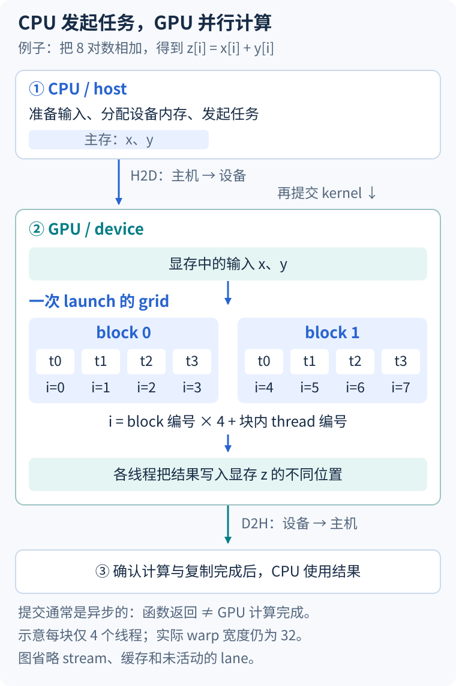
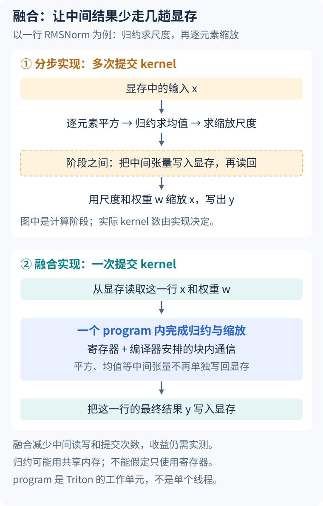

你可能已经用过 `torch.add`、`model.generate()`，也听说过“换一个 kernel，推理就快了”。但 kernel 到底是什么？为什么两段数学公式相同的程序，运行时间可以不同？为什么一张很强的 GPU，也会有大量时间在等待？

**本文中的 kernel，是交给 GPU 执行的一段计算程序。** 学写 kernel，就是学习怎样把计算分给 GPU 上的线程，怎样让它们读取和写回数据，以及怎样判断这种安排是否正确、是否高效。

不需要预先理解 CUDA、warp 或 Tensor Core。前两节从普通加法开始；之后使用 Python 和 Triton 编写真正运行在 GPU 上的代码。你只需能读懂 Python 变量、循环和函数。遇到张量时，可以先把它理解为带有形状的数组。

本文实验设备是本机 **NVIDIA GeForce RTX 5080**。实验代码、环境版本、正确性检查和原始计时一并提供。性能数字只代表这台电脑在记录条件下的样本，不代表所有显卡，也不是完整 LLM 的 tokens/s。高级技术会标明哪些实际运行过，哪些只是进一步阅读的入口。

## 1. Kernel 究竟是什么

### 1.1 从四对数相加开始

假设有两组数：

```python
x = [1, 2, 3, 4]
y = [10, 20, 30, 40]
z = [0] * len(x)
for i in range(len(x)):
    z[i] = x[i] + y[i]
assert z == [11, 22, 33, 44]
```

这里 `i=0` 的计算不需要等 `i=1` 的结果。每个位置都可以独立完成，于是我们可以把不同位置交给不同的执行者。这就是最容易理解的**数据并行**：大家做相似的操作，但处理不同的数据。

GPU kernel 的想法是：写一份“找到自己的位置，把两项相加，再写回”的程序，让很多 GPU 线程执行它。线程可以先理解为一次程序执行的参与者；它有自己的编号和临时变量。

只有四个数时，GPU 通常不是合算的选择。准备任务、提交任务、必要时搬运数据，都有成本。GPU 擅长的是有足够多可并行工作的场景；“用了 GPU”本身不是性能保证。

### 1.2 算子、程序与启动

先分清三个词：

| 名称 | 表达的是什么 | 本文的例子 |
| --- | --- | --- |
| 算子 / operator | 想完成的数学操作 | 两个向量相加、矩阵乘法、RMSNorm |
| kernel | GPU 上执行这项工作的具体程序 | 读取两段数组、相加、写回的代码 |
| launch | CPU 发起一次 kernel 执行 | 指定要启动多少组工作，把指针和参数传过去 |

它们不是严格的一对一关系。一个 PyTorch 算子可能调用多个 kernel；几步算子也可以合并成一个 kernel，这叫 **fusion，算子融合**。同一个矩阵乘法，针对不同输入形状还可能选用不同实现。

因此，优化 kernel 通常不改模型的权重，也不改变目标数学公式，而是在改变计算的执行方式。由于浮点数舍入与运算顺序的影响，“公式一样”仍需要数值验证。

这里的 kernel 与 Linux 内核不是同一概念，也不是机器学习“核方法”中的核函数。LLM kernel 也不是一种独立硬件：它通常就是为大语言模型中的计算设计或选择的 GPU 程序。

### 1.3 CPU 与 GPU 的分工

在本文的离散显卡环境里，先用下面这条路径理解一次任务：

```text
CPU 准备输入 → 数据进入 GPU 显存 → CPU 提交 kernel
           → GPU 读取、计算、写回 → CPU 在需要结果时等待
```

CPU 也叫 **host，主机端**；GPU 叫 **device，设备端**。主存与 GPU 显存是不同的存储位置。`x.cpu()`、`x.cuda()` 之类操作可能涉及设备间复制，不能当作没有成本的标签切换。

连续执行模型时，张量通常会留在 GPU 上，供后续 kernel 使用。不是每算一层都要复制回 CPU。本文计时也会先把输入放在 GPU 上，再测计算；端到端程序则要考虑其实际需要的复制与调度。

[](/img/posts/kernel-lab/cpu-gpu-launch.svg)

*图 1：每个 block 画四个线程只是为了讲清索引；实际 NVIDIA warp 的宽度是 32。图中的两块工作不承诺同时运行。*

还有一个关键事实：**CPU 提交 GPU 任务通常是异步的。** 提交函数返回时，GPU 可能还没算完。stream 可以先理解为一条任务队列：同一条 CUDA stream 中的任务按顺序执行，不同 stream 之间的依赖需要正确安排。以后看到 `synchronize()`，就把它理解为“等相关 GPU 工作完成”。

## 2. 工作如何分给线程

### 2.1 Thread、block 与 grid

CUDA 是 NVIDIA 的通用 GPU 计算平台与编程模型，让 GPU 执行绘图之外的计算。这里先学习它怎样组织工作；不需要立刻掌握 CUDA C++ 的语法。

在 CUDA 编程模型中：

- **thread，线程**：执行代码的参与者。
- **block，线程块**：一组能在规定条件下协作的线程，可以使用块内共享内存与同步。
- **grid，网格**：一次 kernel launch 启动的所有 block。

如果每个 block 有四个线程，用一维索引分工可以写成：

```text
i = block 编号 × 每块线程数 + 块内 thread 编号

block 0: i = 0, 1, 2, 3
block 1: i = 4, 5, 6, 7
block 2: i = 8, 9, 10, 11
```

若只有十个元素，最后两个线程没有合法数据。程序必须判断 `i < 10`，再读写对应位置。这个边界检查看起来小，却是写 kernel 的第一道正确性门槛。

上面只是分工公式，不要求一个线程永远只处理一个元素。实际程序常常让一个线程处理多个元素，也可以让一组线程共同计算一个输出。

### 2.2 Warp 与 SM

NVIDIA GPU 以 **warp** 组织线程执行，一个 warp 有 32 个线程位置，称为 lane。线程执行有条件分支时，一部分 lane 可能暂时不活动；不是每写一个 `if` 都必然变慢，关键是具体执行路径与硬件工作量。

**SM，Streaming Multiprocessor**，是 GPU 上承载线程块执行的硬件单元。一个 SM 可以容纳多个 warp，资源允许时也可以容纳多个 block。调度器通过切换可运行的 warp，让一些工作等待数据时，另一些工作继续执行。

不要把三件事混起来：**block 是程序的工作分组，warp 是线程执行分组，SM 是硬件。** 一次 launch 可以有远多于 SM 数量的 block，它们分批运行；程序不能依赖普通 block 之间的固定先后顺序。

### 2.3 数据放在哪里

| 位置 | 可以怎样理解 | 写 kernel 时要关心什么 |
| --- | --- | --- |
| GPU 全局内存 | 放张量的大仓库，通常由显存支撑 | 访问模式、数据量、缓存命中与复用 |
| L2 等缓存 | 硬件管理的数据副本 | 重复读相同输入可能命中缓存 |
| shared memory | 同一个 block 的协作空间 | 需要正确同步；容量与访问冲突会限制收益 |
| register，寄存器 | 线程计算时保存局部值的资源 | 用量过大会减少可驻留工作，或产生 spill |

这是编程时有用的近似层次，不是“写一个局部变量，就保证永远不访问显存”。编译器决定实际映射；寄存器不够时，某些值可能溢出到由设备内存支撑的 local memory。

相邻线程若读取相邻且合适对齐的地址，硬件通常可以把访问组织成更有效的内存事务，这叫 **coalescing，合并访存**。它与“算子融合”不是同一件事。

### 2.4 并行程序也会出错

在向量加法里，让每个合法输出位置恰好由一个执行者写入，通常最容易保证正确。如果两个线程没有正确协调就写同一个位置，可能产生竞争；如果线程读取另一个线程还没准备好的值，也会出错。

块内同步不能当作全 GPU 同步。跨 block 的算法常需要另一次 kernel launch、原子操作，或更专门的机制。本文先选择没有跨 block 数据依赖的算法。

先记住四个问题，后面每个实验都用得上：**我负责哪些输出？需要读哪些输入？有没有越界？有没有多个执行者互相覆盖？**

## 3. 建立可复现的环境

### 3.1 为什么先用 Triton

CUDA C++ 更直接地暴露线程、线程块和共享内存。Triton 则让我们用接近 Python 的语法描述“一小块数据怎样计算”，编译器再把它映射到 GPU 线程与指令。

本文选 Triton，是为了把第一步集中在索引、读写和数据复用上。它生成并执行真实 GPU kernel；普通 Python 的 `for` 循环不会因为放在同一个文件里就自动变成 GPU 程序。

实验里，PyTorch 负责创建张量、提供参考结果和计时工具；Triton 负责描述我们自己写的 GPU 计算。两者可以共用同一块 GPU 张量，不需要每调用一次 Triton 就复制一份输入。

Triton 的一个 **program instance** 负责一块数据，在这里的 NVIDIA 后端例子中映射到一个 CUDA 线程块。**program 不是一个 thread；处理 256 个元素也不等于启动 256 个线程。** 后面会反复用到这个区别。

### 3.2 安装与版本

本次使用 Windows 宿主机上的 WSL2 Ubuntu，在 Linux 环境中运行上游 Triton。GPU 由 Windows 驱动提供给 WSL；不要把下面命令误认为原生 Windows PowerShell 命令。

先在 PowerShell 查看设备，并进入已经安装好的发行版：

```powershell
nvidia-smi
wsl -d Ubuntu-24.04
```

在 Ubuntu 中建立独立环境：

```bash
sudo apt-get update
sudo apt-get install -y python3-venv python3-dev gcc libc6-dev
python3 -m venv ~/venvs/kernel-lab
source ~/venvs/kernel-lab/bin/activate
python -m pip install torch==2.9.1 --index-url https://download.pytorch.org/whl/cu128
python -m pip install numpy==2.2.6

python - <<'PY'
import sys, torch, triton
print("Python:", sys.version)
print("PyTorch:", torch.__version__)
print("PyTorch CUDA runtime:", torch.version.cuda)
print("Triton:", triton.__version__)
assert torch.cuda.is_available()
print(torch.cuda.get_device_properties(0))
print("Compute capability:", torch.cuda.get_device_capability(0))
PY
```

这组固定版本会安装 PyTorch 对应的 Triton。本文实验用的包版本清单在实验目录中；不是要求所有未来环境一直使用旧版本。

`nvidia-smi` 中的 `CUDA Version` 表示驱动支持的 CUDA 版本范围上限，**不证明机器已经安装对应版本的 CUDA Toolkit**。`torch.version.cuda` 表示这个 PyTorch 构建使用的 CUDA 版本；`nvcc --version` 才是在检查本机的 CUDA 编译器工具链。本文的 PyTorch/Triton 轮子路径不要求另外安装完整 Toolkit 才能运行这几个例子。

不过，Triton 首次运行时仍需要 C 编译器构建主机端的启动辅助代码，所以安装命令保留了 `gcc` 和开发头文件。缺少它们与“GPU 不支持 CUDA”是不同的问题。

本次实际运行环境如下，完整记录也写入了结果 JSON：

| 项目 | 本机实测值 |
| --- | --- |
| GPU | NVIDIA GeForce RTX 5080，84 个 SM |
| Compute capability | 12.0 |
| GPU 总内存 | PyTorch 报告 17,094,475,776 字节；`nvidia-smi` 显示 16,303 MiB |
| Windows 驱动 | 596.49；`nvidia-smi` 的 CUDA Version 为 13.2 |
| Linux 环境 | WSL2，Ubuntu 24.04.5 LTS |
| Python / GCC | 3.12.3 / 13.3.0 |
| PyTorch / CUDA runtime | 2.9.1+cu128 / 12.8 |
| Triton | 3.5.1 |
| 实验日期 | 2026-11-21，Asia/Shanghai |

这张卡同时承担 Windows 桌面显示。实验没有关闭用户应用或锁定频率；原始报告保留了运行前后的温度、时钟、功耗与显存占用快照。

### 3.3 下载实验文件

完整运行约定见[实验说明](/assets/labs/kernel-lab/README.md)。把下列文件分别保存到同一个文件夹：

- [kernels.py](/assets/labs/kernel-lab/kernels.py)：向量加法与 RMSNorm。
- [matmul.py](/assets/labs/kernel-lab/matmul.py)：分块矩阵乘法。
- [lab.py](/assets/labs/kernel-lab/lab.py)：正确性检查、基线、计时和 JSON 报告。
- [first_add.py](/assets/labs/kernel-lab/first_add.py)：下一节的独立入门例子。
- [inspect_codegen.py](/assets/labs/kernel-lab/inspect_codegen.py) 与 [summarize.py](/assets/labs/kernel-lab/summarize.py)：查看编译指令、核对报告与源代码并生成完整表格。

前面的安装命令固定了 PyTorch 与 NumPy，其他依赖仍可能随安装时间变化。若要对齐本次记录的全部 Python 包版本，还需下载 [requirements-lock.txt](/assets/labs/kernel-lab/requirements-lock.txt)，在已激活的 Python 3.12 环境中运行：

```bash
python -m pip install -r requirements-lock.txt
```

在该文件夹运行：

```bash
python lab.py --mode check --output my-checks.json
python lab.py --mode all --output my-results.json
```

先成功跑通 correctness，再看性能。首次运行会编译 kernel，花的时间与稳态执行时间是两回事。

## 4. 写第一个加法 Kernel

### 4.1 最小可运行程序

下面是一个完整的独立例子，保存为 `first_add.py`，在前面的环境中运行 `python first_add.py`。先使用 FP32，也就是每个数占四字节的 32 位浮点类型。

```python
import torch
import triton
import triton.language as tl


@triton.jit
def add_kernel(X, Y, Z, N: tl.constexpr, BLOCK: tl.constexpr):
    offsets = tl.program_id(0) * BLOCK + tl.arange(0, BLOCK)
    valid = offsets < N
    x = tl.load(X + offsets, mask=valid, other=0)
    y = tl.load(Y + offsets, mask=valid, other=0)
    tl.store(Z + offsets, x + y, mask=valid)


def main():
    x = torch.tensor([1, 2, 3, 4, 5], device="cuda", dtype=torch.float32)
    y = torch.tensor([10, 20, 30, 40, 50], device="cuda", dtype=torch.float32)
    z = torch.empty_like(x)
    block = 128
    grid = (triton.cdiv(x.numel(), block),)
    add_kernel[grid](x, y, z, x.numel(), block, num_warps=4)
    torch.cuda.synchronize()
    torch.testing.assert_close(z, x + y, atol=0, rtol=0)
    print(z.cpu().tolist())


if __name__ == "__main__":
    main()
```

期望输出：

```text
[11.0, 22.0, 33.0, 44.0, 55.0]
```

这里 `device="cuda"` 让张量位于 GPU；`empty_like` 分配输出，不保证里面已经是零。因此 kernel 必须覆盖每个应写的位置。

### 4.2 逐行理解索引

`@triton.jit` 标记需要由 Triton 编译的函数。参数 `X`、`Y`、`Z` 在 kernel 中表示设备数据的指针；传入 PyTorch CUDA 张量时，Triton 能获得它们的地址。

`add_kernel[grid](...)` 是 Triton 的启动语法：中括号指定 program 网格，后面的圆括号传入张量和参数。本例 `grid=(1,)` 表示只启动一个 program；不是在读取一个名叫 `add_kernel` 的数组元素。

`tl.program_id(0)` 是当前 program 在第零维网格中的编号。`tl.arange(0, BLOCK)` 生成一组相对位置。两者相加，得到这个 program 负责的全局下标。

例如 `N=300`、`BLOCK=128`：

| program 编号 | 生成的 offsets | 允许实际访问的位置 |
| --- | --- | --- |
| 0 | 0～127 | 全部 |
| 1 | 128～255 | 全部 |
| 2 | 256～383 | 256～299 |

`triton.cdiv(300, 128)` 等于 3，表示向上取整。用普通整除 `300 // 128` 只得到 2，会漏掉尾部数据。

`X + offsets` 表示元素地址的向量，不是“给 X 中的数加上 offsets”。这里地址按元素推进：FP32 指针加一，前进的是四字节。`tl.load` 真正读取这些地址；`tl.store` 真正写回。

`mask` 决定哪些位置允许访问。无效位置的 `other=0` 是这次计算采用的填充值；写回时仍需要 mask。**只在最后加判断，不能弥补前面已经发生的越界读取。**

### 4.3 参数怎样映射到硬件

`BLOCK=128` 表示每个 program 处理 128 个元素。`num_warps=4` 表示这个 program 使用四个 warp，即这里的 128 个 CUDA 线程。两者这一次相等只是参数选择的结果。

把 `BLOCK` 改成 1024，保持 `num_warps=4`，仍然是四个 warp 处理一块 1024 元素的数据；一个线程可能对应多个元素。实际元素到线程的布局由编译器安排。

`N: tl.constexpr`、`BLOCK: tl.constexpr` 是编译时参数。取不同值可能产生新的编译特化。把很多值都设成编译时常量不一定有利：它可能增加编译次数和缓存中的变体。

完整实验里的 `add_into` 增加了接口检查：仅接受同一 GPU 上、相同形状的一维连续 FP32 张量，输出不能与输入重叠，并处理空数组。最小例子用于看清 kernel；包装函数用于明确调用契约。

这些教学 kernel 使用 32 位元素索引，因此完整包装函数还限制每个输入、输出张量最多有 `2**31 - 1` 个元素；RMSNorm 与 GEMM 也遵守这个限制。超出范围时，在启动 GPU 计算之前报错。处理更大张量需要重新设计或使用明确的 64 位索引，不能只看显存是否装得下。

## 5. 先验证，再比较速度

### 5.1 正确性不只测整齐尺寸

`lab.py` 检查了长度 0、1、127、128、129、255、256、257、1023、1024、1025、65537，以及多个 block/warp 配置。这样可以覆盖空输入、小输入、恰好整除和尾部不足一个 program 的情况。

向量加法的参考结果由 PyTorch 计算，要求 `atol=0, rtol=0`。RMSNorm 的参考公式在 FP64 中计算再转成输出类型；矩阵乘法的性能测试输入还使用 CPU FP64 参考，避免只拿两个相似的 GPU 实现相互印证。

这里 FP64 是 64 位浮点数；后面还会用到 16 位的 FP16 和 BF16。FP16 与 BF16 都占两字节，但表示范围和精度不同。可以先把它们理解为不同的存数格式，细节见[浮点精度入门](/2026/10/28/deep-learning-numerical-precision-basics/)。

浮点比较的条件可以理解为：

```text
|实际值 - 参考值| <= atol + rtol × |参考值|
```

归约与矩阵乘法会改变累加顺序，不应默认要求逐位一致。容差要结合数据类型、输入范围和用途确定；本文 JSON 逐项记录容差和最大绝对误差，没有把“运行不报错”当成数值正确。

RMSNorm 另外覆盖全零输入和放大到约千量级的输入：FP16 最大有限值为 65504，而 `1000² = 1000000` 已超出范围，所以要在平方**之前**提升到 FP32。非连续输入、零行宽和超出教学范围的行宽则明确拒绝。

这些检查没有证明任意输入都正确，也不等价于 GPU 内存检查工具。本文没有为这些函数实现反向传播，包装函数拒绝需要梯度的输入，实验运行在 `torch.inference_mode()` 下。

### 5.2 避开异步计时陷阱

下面这种 CPU 计时，如果没有恰当同步，可能主要测到提交任务的时间：

```python
# 反例：这一段不能作为 GPU 已完成计算的计时证据。
t0 = time.perf_counter()
some_gpu_operation()
t1 = time.perf_counter()
```

本文使用 CUDA Event。它在 GPU 时间线上记录事件，再等待结束事件完成：

```python
# 放在已完成 import、准备好 fn 的程序中；fn 是不带参数的被测函数。
for _ in range(30):
    fn()
torch.cuda.synchronize()

start = torch.cuda.Event(enable_timing=True)
end = torch.cuda.Event(enable_timing=True)
start.record()
for _ in range(64):
    fn()
end.record()
end.synchronize()
microseconds_per_call = start.elapsed_time(end) * 1000 / 64
```

不过，这仍不保证得到“纯指令执行时间”：当 Python 提交赶不上 GPU 时，事件之间可能包括等待下一次提交的空隙。

### 5.3 本文的计时口径

主表采用 **CUDA Graph 重放**：先捕获连续 64 次调用，再计时一次 graph replay，除以 64。这样减少逐次 Python 提交对小 kernel 的干扰。图本身仍有调度成本，因此这也是一种明确的测量条件，不是绝对“无开销”的时间。

每个候选先预热 30 次；捕获后再预热五次 graph replay。记录九个样本，报告中位数和最小～最大值。每个形状内的候选用固定随机种子打乱测试顺序；没有锁定 GPU 时钟，也没有宣称消除了桌面活动与温度的影响。

实际观察到小算子有明显波动，所以又完整复测了一轮 graph 模式。**正文主表统一引用首轮，不从两轮中逐项挑最快值。** 两轮原始数据都保留；最小～最大是观察到的范围，不是统计置信区间。benchmark 开始前重新设置随机种子，确保不同运行模式使用相同的测试输入和候选顺序。

输入、输出留在 GPU 上，重复使用同一组缓冲区，不主动刷新缓存。计时排除首次编译、数据生成、设备间复制和 graph capture。加法与矩阵乘法的双方都使用预分配输出；RMSNorm 的双方都返回新张量，图捕获管理其内存，重放不包含 Python 分配路径。

若想观察普通提交路径，可以运行：

```bash
python lab.py --mode bench --timing events --output my-events.json
```

两种口径不能混成一张“谁更快”的榜单。生产程序没有使用 CUDA Graph 时，不能直接把 graph 重放数字当作它的单次调用延迟。

## 6. 从向量加法学习优化

### 6.1 先算要搬多少数据

每个 FP32 加法输出需要读取 `x[i]`、`y[i]`，再写一个 `z[i]`。按算法的最低读写量计算，是 `4 + 4 + 4 = 12` 字节，只有一次加法。

因此，较大向量的这个算法值得优先检查访存与任务划分，而不是想办法让加法指令更花哨。常见分析量是**算术强度**：算多少次浮点操作，除以搬多少字节。这个简单模型下，加法是 `1/12 FLOP/byte`。

FLOP 表示一次浮点运算；FLOP/s 表示每秒完成的浮点运算数。本文计算矩阵乘法工作量时，把一次乘法和一次加法计为两次操作，这是一种常用计数约定。

用 `12 × N / 时间` 可以算出 effective GB/s，本文使用十进制 GB。它是按逻辑数据量折算的有效吞吐，**不等于实际测得的 DRAM 带宽**：缓存、事务大小等都可能改变真正的显存流量。

### 6.2 扫描 block 与 warp

实验只改变每个 program 处理多少元素，以及使用多少个 warp，保持公式和输入不变。为什么不能简单地说“越大越快”？

- 块太小，program 数量变多，每组工作太少。
- 块变大，单个 program 的寄存器与执行安排也会变化。
- warp 变多，可能改善等待隐藏，也可能消耗更多资源。
- 小输入可能主要受调度成本影响，大输入则有不同瓶颈。

这些都是需要通过测量检验的解释，不是从参数大小就能推出的结论。

下表是首轮 graph 计时的中位数，单位 **µs**，越小越好。`B` 是每个 program 的元素数，`W` 是 warp 数；[完整表格](/assets/labs/kernel-lab/results/rtx5080-graph-tables.md)还记录了每项的最小～最大值。

*手机上可以左右滑动下面的性能表，查看完整列。*

<div style="overflow-x: auto;" role="region" aria-label="向量加法实测结果，可横向滚动" tabindex="0" markdown="1">

| N | torch.add | B128/W4 | B256/W4 | B1024/W4 | B1024/W8 |
| --- | ---: | ---: | ---: | ---: | ---: |
| 1,024 | 3.364 | 3.534 | 0.822 | 1.217 | 0.943 |
| 1,048,576 | 4.218 | 4.629 | 4.173 | 3.859 | 4.112 |
| 16,777,216 | 262.391 | 262.507 | 266.750 | 265.258 | 261.431 |
{: style="min-width: 760px; table-layout: auto;"}

</div>

可以沿着一次具体修改看结果：在 `N=1,048,576` 时，固定四个 warp，把 BLOCK 从 128 改为 1024，中位数从 **4.629 降到 3.859 µs**；再改为八个 warp，反而升到 **4.112 µs**。复测对应为 4.886、3.871、3.220 µs：扩大 BLOCK 的这一步仍然缩短了时间，增加 warp 的效果却与首轮相反。两轮结果不支持“warp 越多越快”，也不能只选其中一轮来决定四个和八个 warp 谁更好。

这个中等向量的 B1024/W8，首轮样本范围为 **3.104～4.273 µs**，按中位数和逻辑字节量算出约 **3060.0 GB/s**。输入输出合计只有 12 MiB，缓存会影响重复缓冲区实验；这个数不能作为显存物理带宽的测量值。本文没有采集访存计数器，也没有据此报告缓存命中率。

小向量则更能说明不确定性：B128/W4 在首轮是 3.534 µs，复测变为 0.834 µs；`torch.add` 从 3.364 变为 0.990 µs。B256/W4 虽然两轮中位数都最低，但复测只比 B128/W4 少 0.002 µs。**这组数据不足以为 1024 个元素宣布一个稳定的最佳配置。**

`N=16,777,216` 时，仅两个输入和一个输出合计就有 192 MiB 的逻辑工作集。这个点比几千字节的小向量更适合观察大规模流式访问；仍不能仅凭 effective GB/s 断言硬件瓶颈已经被精确定位。

真正的优化记录应该包含“改了什么、在什么输入上、相对哪个基线、结果有没有更好”。如果一个手写加法没有超过 `torch.add`，它依然完成了学习任务：你已经理解了编程模型，也知道成熟库的实现是必须尊重的基线。

## 7. 写一个 LLM 归一化算子

### 7.1 RMSNorm 的数学含义

很多 LLM 使用 RMSNorm。先把输入看成二维数组 `X[M, N]`：`M` 行可以对应展平后的 token 数，`N` 列对应一个 token 的隐藏维度。

对每一行，计算：

```text
mean_square = (x[0]² + x[1]² + ... + x[N-1]²) / N
scale       = 1 / sqrt(mean_square + eps)
y[j]        = x[j] × scale × weight[j]
```

`weight[N]` 是学习得到的缩放参数。`eps` 是加在分母平方根内部的小正数，用于避免零输入时除以零。本文固定为 `1e-6`。

例如 `x=[3,4]`、`weight=[1,1]`，忽略很小的 eps，均方为 `12.5`，输出约为 `[0.8485, 1.1314]`。RMSNorm 不需要像普通 LayerNorm 那样先减去均值；不要把两者混为一个公式。

把一行中的多个数合成一个平方和，是 **reduction，归约**。它与向量加法的区别是：同一行内的数据需要汇总，才能得到这一行所有元素共用的 scale。

先用 PyTorch 把公式直接写出来，得到 `kernels.py` 中的普通 eager 基线。eager 的意思是按当前程序逐步执行操作，没有在这里显式调用 `torch.compile` 做图编译：

```python
def rms_eager(x, weight, eps=1e-6):
    xf = x.float()
    return (xf * torch.rsqrt((xf * xf).mean(dim=-1, keepdim=True) + eps)
            * weight.float()).to(x.dtype)
```

`dim=-1` 表示沿最后一维，也就是一行的各列求均值；`keepdim=True` 保留长度为一的维度，使每行的 scale 能广播到这一行的所有元素。先读懂这段普通程序，再看怎样把它放进一个 kernel。

### 7.2 一行交给一个 program

下面是 `kernels.py` 中的核心实现；使用前面的 imports，它由同文件中的 `rms_norm` 包装函数分配输出并启动：

```python
@triton.jit
def rms_kernel(X, W, Y, N: tl.constexpr, EPS: tl.constexpr,
               BLOCK: tl.constexpr):
    row = tl.program_id(0)
    cols = tl.arange(0, BLOCK)
    x = tl.load(X + row * N + cols,
                mask=cols < N, other=0).to(tl.float32)
    w = tl.load(W + cols,
                mask=cols < N, other=0).to(tl.float32)
    mean_square = tl.sum(x * x, axis=0) / N
    y = x * tl.rsqrt(mean_square + EPS) * w
    tl.store(Y + row * N + cols, y, mask=cols < N)
```

每行的起点是 `row * N`，这是**行连续存储**的前提。如果传入转置张量，它的实际步长可能不同；本文直接拒绝非连续输入，而不是在同一个公式里偷偷假设它仍然连续。

`BLOCK = triton.next_power_of_2(N)`。例如 `N=1537` 时，用 2048 个位置描述这行，超出范围的 `x` 填零。平方和除以的仍然是 **1537，不是 2048**。填充值是为了方便计算，不能改变数学上的行宽。

平方、归约和归一化在 FP32 中完成，最后 store 转成输出类型。`tl.sum` 描述归约，编译器负责生成线程之间需要的协作；不能把它理解为一个线程串行运行 2048 次加法，也不能假定它绝不会使用共享内存。

这个教学版本约束 `1 <= N <= 8192`。更宽的行需要重新考虑资源占用与划分方式。`M=1` 时也只有一个 program，不能期待它把整张 GPU 的所有 SM 都用满。

### 7.3 融合省下了什么

在 PyTorch 中逐步写出公式，可能形成转换、平方、均值、加 eps、倒数平方根、乘法和转换输出等工作。中间结果可能需要写入设备内存，再被下一步读回来；具体 kernel 数量由版本和实现决定。

融合版本把一行的数据读入后，尽可能在 program 内完成这些步骤，直接写最终结果。收益可能来自减少中间张量读写，也可能来自减少 kernel launch。

[](/img/posts/kernel-lab/fusion-memory.svg)

*图 2：展示数据依赖与中间张量的区别；不把“一个数学步骤”画成保证存在的“一个 GPU kernel”。*

公平比较不能只选择一个刻意拆散的基线。因此实验同时测：显式 FP32 中间值的 PyTorch eager 公式、`torch.nn.functional.rms_norm`，以及手写 Triton 的两个 warp 配置。原生函数可能采用不同中间舍入；三者都先与 FP64 数学参考做有容差的比较。

三个实现都显式使用 `eps=1e-6`。PyTorch 原生 RMSNorm 默认的 eps 与数据类型有关；如果省略这个参数，就可能在比较不同的公式。主表已经通过 CUDA Graph 减少 CPU 提交开销，因此融合后的收益还需要结合 GPU 内部调度与中间读写理解，不能全部归因于省去了 Python 调用。

首轮 graph 中位数如下，输入与输出都是 FP16，单位 µs：

<div style="overflow-x: auto;" role="region" aria-label="RMSNorm 实测结果，可横向滚动" tabindex="0" markdown="1">

| M×N | PyTorch eager 公式 | F.rms_norm | Triton W4 | Triton W8 |
| --- | ---: | ---: | ---: | ---: |
| 1×4096 | 10.890 | 2.932 | 1.259 | 1.228 |
| 32×4096 | 16.585 | 2.946 | 1.941 | 1.430 |
| 1024×4096 | 68.862 | 8.675 | 6.339 | 6.313 |
| 257×1537 | 16.534 | 8.132 | 2.103 | 2.226 |
{: style="min-width: 680px; table-layout: auto;"}

</div>

以 `1024×4096`、默认 W4 为例，Triton 首轮范围是 **6.206～9.790 µs**。按中位数计算，相对展开的 eager 公式，加速比约为 **10.86**；相对原生 `F.rms_norm`，加速比则约为 **1.37**。这两个数字回答的是不同的比较问题，不能只拿前者概括“比 PyTorch 快多少”。

复测中，eager、原生函数、Triton W4 分别为 69.742、8.202、6.313 µs，仍保留相同的速度关系。但 `32×4096` 的 Triton W4 首轮为 1.941 µs，快于原生函数的 2.946 µs；复测变为 3.882 µs，慢于原生函数的 2.957 µs。这里只能报告观察到的排名变化，没有 profiler 证据把它单独归因于某一种硬件原因。

这里有价值的不是一个孤立的加速倍数，而是同一个公式在不同 token 数下的行为。融合也并非总有利：如果融合后寄存器过多、并行度不足，或原本就有很好的库实现，收益会消失甚至变慢。

## 8. 从加法走到矩阵乘法

### 8.1 一个输出需要多个乘加

GEMM 是 General Matrix Multiplication 的缩写，通常指通用矩阵乘法。本文实现它最基础的形式，不带额外缩放与已有输出累加。

矩阵乘法写成 `C = A @ B`，形状是：

```text
A: [M, K]    B: [K, N]    C: [M, N]
C[i,j] = sum(A[i,k] × B[k,j], k=0...K-1)
```

可以先用小矩阵手算：

```text
A = [[1, 2],       B = [[5, 6],       C = [[19, 22],
     [3, 4]]            [7, 8]]            [43, 50]]

C[0,0] = 1×5 + 2×7 = 19
```

与向量加法不同，同一个 `A[i,k]` 会参与多个输出列，同一个 `B[k,j]` 会参与多个输出行。于是优化的重点之一是**复用**：已经读到的数据，能不能多用几次？

### 8.2 分块的执行方式

教学实现让一个 program 负责 `BLOCK_M × BLOCK_N` 的输出块，沿 K 维分段推进：

```text
acc = 一块 FP32 的零
每次取 K 方向的一小段：
    读取 A 的 [BLOCK_M, BLOCK_K] 子块
    读取 B 的 [BLOCK_K, BLOCK_N] 子块
    acc += 两块的矩阵乘积
写出 acc 对应的输出块
```

例如每轮读取 `32×32` 的 A 子块和 `32×64` 的 B 子块，为 `32×64` 个输出累积一段贡献。按一次乘加算两次浮点操作，这轮有 `2×32×64×32 = 131072` FLOPs；两个 FP16 输入子块共 6144 字节。这是说明块内复用的算法算例，没有把输出写回、跨块重复读取和缓存等成本全部算进去。

完整包装与参数检查在 [matmul.py](/assets/labs/kernel-lab/matmul.py)。下面是其中的 kernel，使用前面的 `torch`、`triton` 和 `tl` 导入：

```python
@triton.jit
def _matmul_kernel(
    A, B, C,
    M: tl.constexpr, N: tl.constexpr, K: tl.constexpr,
    BLOCK_M: tl.constexpr, BLOCK_N: tl.constexpr, BLOCK_K: tl.constexpr,
):
    rows = tl.program_id(0) * BLOCK_M + tl.arange(0, BLOCK_M)
    cols = tl.program_id(1) * BLOCK_N + tl.arange(0, BLOCK_N)
    inner = tl.arange(0, BLOCK_K)
    acc = tl.zeros((BLOCK_M, BLOCK_N), dtype=tl.float32)
    for tile in range(tl.cdiv(K, BLOCK_K)):
        ks = tile * BLOCK_K + inner
        a = tl.load(
            A + rows[:, None] * K + ks[None, :],
            mask=(rows[:, None] < M) & (ks[None, :] < K),
            other=0.0,
        )
        b = tl.load(
            B + ks[:, None] * N + cols[None, :],
            mask=(ks[:, None] < K) & (cols[None, :] < N),
            other=0.0,
        )
        acc = tl.dot(a, b, acc)
    tl.store(
        C + rows[:, None] * N + cols[None, :],
        acc.to(tl.float16),
        mask=(rows[:, None] < M) & (cols[None, :] < N),
    )
```

读完整代码时，先把二维下标还原成一维地址。行连续存储的 `A[M,K]` 中，`A[i,k]` 位于 `A + i*K + k`；`B[K,N]` 中，`B[k,j]` 位于 `B + k*N + j`。

`rows[:, None]` 把行号变成一列，`ks[None, :]` 把 K 方向下标变成一行；两者广播组合，就得到一个二维地址网格。例如行号 `[0,1]`、K 下标 `[0,1,2]`、实际 K 为 3 时，`rows[:,None]*3 + ks[None,:]` 得到 `[[0,1,2],[3,4,5]]`。这与手写两层 Python 循环枚举地址表达的是同一组位置。

二维 grid 分别决定输出的行块和列块。M、N、K 尾部都需要 mask，加载无效输入填零，输出只写合法位置。代码用 FP16 输入、FP32 累加、FP16 输出，支持不整除的形状，但不实现批量 GEMM、转置步长、bias、split-K 或反向传播。

这个二维启动方式还受 CUDA 网格维度限制：`ceil(N / BLOCK_N)` 不能超过 65535，包装函数会提前拒绝超限的列块数。它与前面的张量元素数限制是两件事；即使显存装得下，启动网格也必须合法。

### 8.3 Tensor Core 与精度

Tensor Core 是 GPU 中加速特定矩阵运算的硬件执行单元。Triton 的 `tl.dot` 描述矩阵乘加；编译器结合数据类型、布局与目标架构决定怎样生成指令。它与“把 Python 的乘法写得更短”不是一回事。

不能把所有名为 Blackwell 的 GPU 当成同一种目标。RTX 5080 的 compute capability 是 12.0；面向数据中心 Blackwell 的某些架构专用指令与教程，不能直接照搬到这张卡。

这次也实际检查了生成的 PTX。运行：

```bash
python inspect_codegen.py --output my-codegen.json
```

在 `M=N=K=128`、tile 为 `32×64×32`、四个 warp、`num_stages=3` 的配置下，Triton 3.5.1 生成了：

```text
mma.sync.aligned.m16n8k16.row.col.f32.f16.f16.f32
```

这为本例使用矩阵乘加指令提供了编译产物证据；编译对象报告每线程 52 个寄存器、每 program 12,288 字节共享内存。它不是最终 SASS，也不是硬件性能计数器结果，不能据此计算出实际 Tensor Core 利用率。[完整记录](/assets/labs/kernel-lab/results/rtx5080-codegen.json)包含配置、代码校验值和正确性检查结果。

FP32 累加也不保证与 FP64 参考逐位一致：输入本来就经过 FP16 表示，累加顺序可能变化，最终输出还会再次舍入到 FP16。实验关闭 PyTorch 的 TF32 与 FP16 reduced-precision reduction，记录它们的设置，并检查每个计时形状的输出。

### 8.4 与库实现对照

首轮 graph 中位数如下，单位 µs。形状顺序是 **M×N×K**；Triton 列标题是 tile 的 `BLOCK_M×BLOCK_N×BLOCK_K` 与 warp 数，固定 `num_stages=3`。

<div style="overflow-x: auto;" role="region" aria-label="矩阵乘法实测结果，可横向滚动" tabindex="0" markdown="1">

| M×N×K | torch.mm | 32×64×32 / W4 | 64×64×32 / W4 | 64×128×32 / W8 |
| --- | ---: | ---: | ---: | ---: |
| 1×1024×1024 | 5.685 | 5.966 | 8.997 | 15.361 |
| 128×512×512 | 4.305 | 3.751 | 5.455 | 8.119 |
| 1024×1024×1024 | 26.558 | 25.315 | 27.015 | 27.128 |
| 257×513×255 | 4.486 | 5.082 | 6.442 | 7.935 |
{: style="min-width: 760px; table-layout: auto;"}

</div>

默认 `32×64×32 / W4` 在首轮的 `1024³` 上中位数略低于 `torch.mm`，样本范围为 **25.207～34.601 µs**，按中位数与 `2MNK` 折算约 **84.83 TFLOP/s**。复测两者为 25.303 与 26.540 µs。这个有限比较不能推出手写实现普遍优于库，也不能把有用工作量折算出的吞吐当成 GPU 峰值算力。

`128×512×512` 的默认实现首轮为 3.751 µs，快于 `torch.mm` 的 4.305 µs；复测却是 3.934 对 3.333 µs，排名反转。`M=1` 与不整除的 `257×513×255` 则在两轮中都是默认实现更慢。把 tile 扩大到 `64×128`、使用八个 warp，在 `M=1` 的例子中还明显增加了耗时；“块更大”“用了更多线程”都不是优化成立的证据。

`torch.mm` 是必须保留的成熟库基线。教学分块实现还没有库中的大量形状特化与调度策略；跑通 Tensor Core 并不意味着已经写出了最优 GEMM。

尤其是 `M=1` 时，宽大的输出 tile 中大多数行都被 mask 掉。代码逻辑上正确，执行方式却可能不适合这个形状。它提醒我们：**正确实现一个算子，与为某种负载写出合适的 kernel，是两层工作。**

## 9. 把 Kernel 放回 LLM

### 9.1 一层模型会调用什么

以常见 decoder-only Transformer 为例，可以把一层的部分计算理解为：

```text
隐藏状态 → 归一化 → Q/K/V 投影 → Attention → 输出投影 → 残差
        → 归一化 → FFN 投影、门控激活、再投影 → 残差
```

具体排列依模型而定。这条路径包含多种任务：矩阵乘法、逐元素运算、归约、数据布局变换等，并不只有一个“LLM kernel”。本文的加法对应逐元素操作的基本模式；RMSNorm 对应归一化；GEMM 对应大量线性投影。

Attention 的数学表达式常写成：

```text
softmax(Q Kᵀ / sqrt(d) + mask) V
```

softmax 要处理减最大值、指数、求和和归一化，数值稳定性很重要。融合 Attention 可以进一步减少中间矩阵读写，但它比本文的一行归约复杂，不能只在 RMSNorm 代码中换一个公式就完成。

### 9.2 Prefill 与 decode 的形状

Prefill 处理输入上下文，通常有较多 token 可以一起进行投影；普通自回归 decode 中，每条序列每步新产生一个 token。实际服务还会有批处理、多个请求和缓存管理。

把线性层近似看成 `X[T,K] @ W[K,N]`，T 改变后，适合的 kernel 也可能改变。本文 GEMM 的 `M=1` 与 `M=1024` 就提供了一个受控的形状对照，**没有把它们冒充成完整模型的 decode/prefill benchmark**。

在“权重至少完整读取一次、不考虑缓存与其他流量”的简化 FP16 模型里，计算量约为 `2TKN`，权重字节量为 `2KN`，仅按权重估计的算术强度约为 `T FLOP/byte`。它说明为什么多 token 有利于复用权重，不是对真实显存流量的测量。

### 9.3 单算子与整体速度

假设一个算子占原来总时间的 10%，现在把它加速到两倍，其他部分不变，那么整体加速比是：

```text
1 / (0.9 + 0.1 / 2) ≈ 1.053
```

也就是大约 5.3%，而不是整个模型都快一倍。这是可直接计算的 Amdahl 定律算例，不是本文实测。

因此，对模型做优化时，应先看 profiler 中时间花在哪里，再选择优化对象。单算子微基准、单层推理和端到端服务延迟，回答的是不同问题。

## 10. 继续学习的方向

### 10.1 用证据定位瓶颈

本文实测范围是前面的三个算子、两种提交口径，以及一个配置的 PTX 检查。下一步可以使用下列工具建立更细的证据；工具是否可用还受平台、安装版本和性能计数器权限影响。

| 工具或检查 | 主要回答什么 | 不能直接推出什么 |
| --- | --- | --- |
| PyTorch profiler / Nsight Systems | CPU 与 GPU 时间线、调用与等待、kernel 间空隙 | 仅凭总时长不能精确定位所有硬件瓶颈 |
| Nsight Compute | 一个 kernel 的访存、资源占用、执行指标 | occupancy 高不自动等于更快 |
| 编译产物、PTX / SASS | 编译器生成了哪些指令与资源需求 | 看到一条矩阵指令不等于整体性能优秀 |
| Compute Sanitizer | 支持的目标与模式下检查越界、部分竞争和同步错误 | 数值正确性仍需要独立参考 |

`occupancy` 常用来表示实际驻留 warp 数相对硬件上限的比例。它是帮助分析等待隐藏与资源限制的指标，不是目标分数。寄存器、共享内存和 block 资源都会参与约束。

本文的边界测试不替代 Compute Sanitizer；未运行的 profiler 或 sanitizer 检查不会记为“通过”。

### 10.2 调参、流水线与融合

在本文参数扫描的基础上，可以进一步学习：

- **autotuning**：对不同形状测试多个配置，缓存适合的选择。编译与搜索成本要单独统计，也要保留未参与选择的形状检验泛化。
- **shared-memory tiling 与流水线**：协调数据搬运与计算，让下一块数据准备与当前计算尽可能重叠。需要理解同步、资源限制和目标架构。
- **persistent kernel**：让一组常驻工作继续领取任务，减少某些调度成本；负载均衡与资源占用也可能更难。
- **更大的融合范围**：例如残差加法与 RMSNorm，或线性层后的门控激活。先确认算子的数学契约、输出用途和中间值能否省略。

这些是学习方向，本文没有测量它们的加速比。每次尝试都应回到同一套步骤：写清输入契约，验证边界与精度，明确基线和计时方式，再看收益。

### 10.3 Attention 与量化

FlashAttention 的关键之一是分块计算 Attention，结合在线 softmax，减少对大中间矩阵的高带宽内存读写。它不是把 Attention 随意近似掉；具体实现仍存在浮点差异，也有形状、dtype 和架构约束。本文没有复现 FlashAttention 性能，进一步阅读见原论文与实现资料。

量化 kernel 则增加了低位数据打包、scale、反量化和对应计算指令等问题。存储字节数减少不等于执行时间按同比例减少；如果解包、转换和额外访存成为瓶颈，就需要把这些步骤一起考虑。

继续深入 CUDA C++、CUTLASS 或更底层的 PTX 时，本文建立的索引、归约、复用、精度和测量方法仍然适用。变化的是你手动控制的层次越来越细。

## 11. 复现记录与练习

本次最小加法示例输出与预期一致。主实验通过 **303 项检查**：259 项边界、数值与错误输入检查，加上 44 项计时候选的数值检查。普通 events 计时与 graph 复测又分别完成 44 项计时候选检查；PTX 检查程序也单独验证了其 GEMM 输出。

每轮性能测试共 **47 组形状／实现组合**。

其中三个 `torch.add(out)` 是加法计时基线；加法参考本身由 PyTorch 计算，没有再单独对这个基线做自检。其余 44 个计时候选均做了数值比较，所以计时条目数与数值检查数不同。

原始文件和完整表格可以直接下载：

| 记录 | 原始数据 | 完整表格 |
| --- | --- | --- |
| 首轮 CUDA Graph，正文主表来源 | [JSON](/assets/labs/kernel-lab/results/rtx5080-graph.json) | [Markdown](/assets/labs/kernel-lab/results/rtx5080-graph-tables.md) |
| CUDA Graph 复测，保留波动 | [JSON](/assets/labs/kernel-lab/results/rtx5080-graph-repeat.json) | [Markdown](/assets/labs/kernel-lab/results/rtx5080-graph-repeat-tables.md) |
| 普通 Python 提交 + CUDA Event | [JSON](/assets/labs/kernel-lab/results/rtx5080-events.json) | [Markdown](/assets/labs/kernel-lab/results/rtx5080-events-tables.md) |
| 编译产物检查 | [JSON](/assets/labs/kernel-lab/results/rtx5080-codegen.json) | — |
| Python 包版本 | [requirements-lock.txt](/assets/labs/kernel-lab/requirements-lock.txt) | — |

JSON 记录 GPU、软件版本、输入形状、计时参数、九个原始样本、误差与容差，以及按 UTF-8/LF 规范化的 Python 源码 SHA-256。`summarize.py` 会先核对源码校验值，再从 JSON 重新生成完整表格；源码改过后，旧报告不应继续冒充新版本的结果。

```bash
python first_add.py
python lab.py --mode all --output my-results.json
python summarize.py my-results.json
python lab.py --mode bench --timing events --output my-events.json
python inspect_codegen.py --output my-codegen.json
```

普通提交模式也提供了一个重要的反例：`1024×4096` RMSNorm 的 Triton W4 是 **19.216 µs**，原生函数是 **11.215 µs**；graph 模式中，二者却是 6.339 与 8.675 µs。这个 Python 包装函数包含参数检查和启动逻辑，普通提交路径会把它们造成的 GPU 等待也反映到事件区间中。**graph 模式下更快的实现，不保证普通 Python 调用也更快。** 这正是需要同时明确执行方式和基准口径的原因。

未完成的验证范围也应清楚保留：没有运行 Compute Sanitizer、Nsight 性能分析、反向传播或完整 LLM 推理；没有测量 FlashAttention、量化或多卡通信。本文不为这些部分提供性能承诺。

推荐按顺序完成下面几项练习：

1. 用纸笔写出 `N=300, BLOCK=128` 时每个 program 的有效下标，再与第一个 kernel 对照。
2. 把最小加法例子改成 `z = 2*x + y`，用 PyTorch 写参考，并测试 127、128、129 三个长度。
3. 固定输入，只改 `BLOCK` 和 `num_warps`，保留每个配置的原始样本；解释为什么一次“最好成绩”不足以选择配置。
4. 为 RMSNorm 增加一个 `N=1009` 的正确性用例，检查补零后除数仍然是 1009。
5. 在矩阵乘法中比较 `M=1` 与较大的 M，画出每个 output tile 中有效位置占多少，再看实际耗时。
6. 选择一个真实模型，用 profiler 找出值得优化的算子；在拿到端到端结果前，把结论限定为单算子结果。

不要通过删除 mask 来“测一个更快版本”，然后把越界行为当作优化。更有价值的下一步是让接口明确区分整除快路径和通用路径，再分别验证。

## 参考资料

- [NVIDIA CUDA Programming Model](https://docs.nvidia.com/cuda/cuda-programming-guide/01-introduction/programming-model.html)：grid、block、thread 与执行模型。
- [CUDA C++ Best Practices Guide](https://docs.nvidia.com/cuda/cuda-c-best-practices-guide/index.html)：计时、访存、资源与性能分析。
- [NVIDIA CUDA GPU Compute Capability](https://developer.nvidia.com/cuda/gpus)：设备对应的计算能力。
- [CUDA Compute Capabilities 与技术限制](https://docs.nvidia.com/cuda/cuda-programming-guide/05-appendices/compute-capabilities.html)：网格维度等硬件限制。
- [Triton：Vector Addition](https://triton-lang.org/main/getting-started/tutorials/01-vector-add.html)：program、索引与 mask。
- [Triton：Fused Softmax](https://triton-lang.org/main/getting-started/tutorials/02-fused-softmax.html)：归约、融合与中间读写。
- [Triton：Matrix Multiplication](https://triton-lang.org/main/getting-started/tutorials/03-matrix-multiplication.html)：分块矩阵乘法。
- [PyTorch 2.9：CUDA semantics](https://docs.pytorch.org/docs/2.9/notes/cuda.html)：异步执行、精度设置与 CUDA Graph。
- [PyTorch 2.9：RMSNorm](https://docs.pytorch.org/docs/2.9/generated/torch.nn.RMSNorm.html)：公式与默认 epsilon。
- [RMSNorm 原论文](https://arxiv.org/abs/1910.07467)：归一化公式与方法。
- [FlashAttention 原论文](https://arxiv.org/abs/2205.14135)：通过分块减少 Attention 的内存读写。
- [NVIDIA Compute Sanitizer](https://docs.nvidia.com/compute-sanitizer/ComputeSanitizer/index.html)：设备端内存与同步检查。
